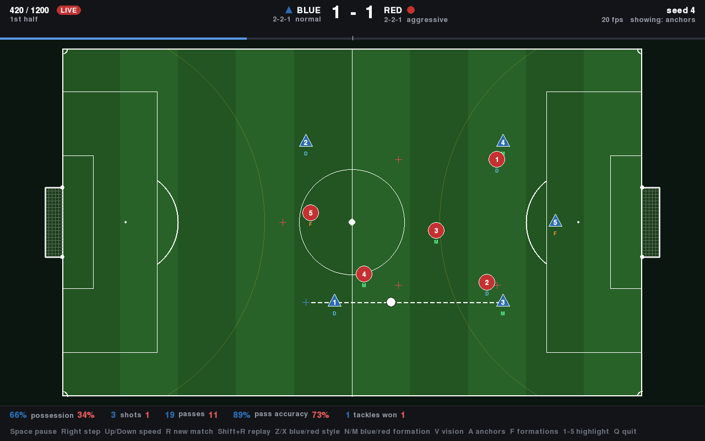
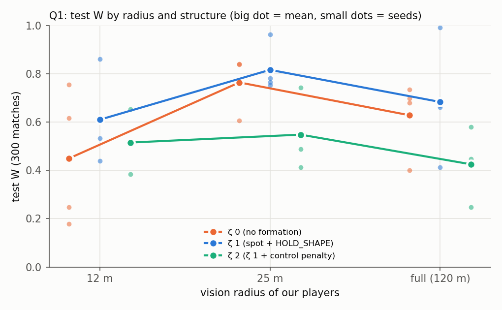
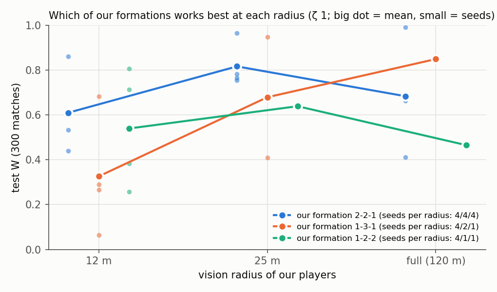
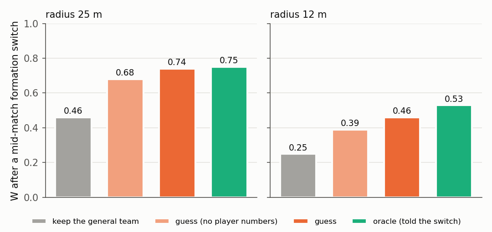
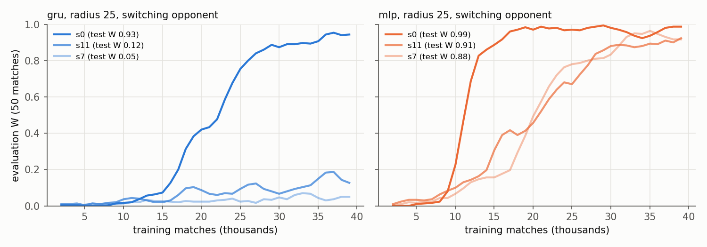
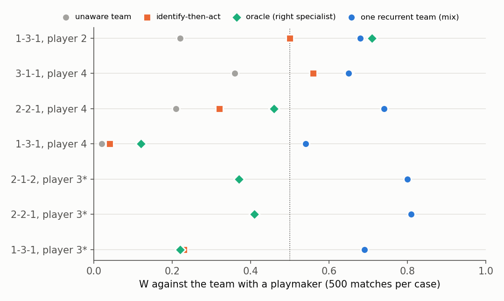

# Summary

We built a small 2D football game (five players a side) and trained a team of AI players with reinforcement
learning against a hand-coded opponent. Every player sees opponents only within a limited radius. Around this we
asked three questions on one theme: **when players cannot see everything, what helps more, structure (a formation)
or information (working out what the opponent is doing)?**

| Question | Short answer |
|---|---|
| **Q1.** Can a formation make up for limited vision? | **No, not measurably.** Giving the team a formation changed its win score by +0.09 ± 0.15 overall, and enforcing the formation by −0.12 ± 0.16. Neither is distinguishable from zero, and no formation (2-2-1, 1-3-1, 1-2-2) was reliably best at any radius. How a training run happened to go mattered far more than the formation did. Seeing more did not help either: teams with a 25 m view scored at least as well as teams with full vision. |
| **Q2.** How quickly can the team notice that the opponent changed formation? | **Very quickly, in about 30 steps (2–3% of a match).** A simple probabilistic filter over what our players see spots the change and keeps almost all of the benefit of being told (W 0.74 against 0.75). Teams trained end to end did not learn to spot the change at all. They learned one way of playing that beats both formations. |
| **Q3.** Can the team identify and neutralize an opponent "playmaker"? | **Partly by identification, much better by learning.** The playmaker turns our winning team (W 0.82–0.90) into a losing one (0.02–0.41). Identifying him and switching to a specialist wins back part of the loss but stays below an oracle. A single recurrent team trained on every case did best of all (W 0.70 against 0.35 for identify-then-act and 0.42 for the oracle). |

The common thread is that **robust play beat explicit reasoning about the opponent**. Q2 and Q3 both show this. The
results also showed how much one training run can differ from the next, which is why every claim below is backed by
several independent training runs (seeds) and a 95% interval.

# 1. The game and the learning team

**The game.** Two teams of five outfield players (no goalkeepers) play on a 100 × 60 m pitch. A match lasts
1,200 steps. In each step every player picks one action: walk in one of 8 directions, stand, run to the ball, pass
to a teammate, play a through ball, dribble, shoot, tackle, "hold shape" (go to your formation spot) or "shadow" an
opponent (stand between him and our goal). More goals after 1,200 steps wins.

**Limited vision.** Each of our players sees opponents only within a **vision radius r** of himself: 12 m, 25 m or
the full pitch. Teammates and the ball are always visible. The opponent always plays with 25 m vision.

**The opponent** is a hand-coded zonal team. It defends its zones, presses the ball carrier and passes when a pass is
safe. It can play five formations: 2-2-1, 2-1-2, 1-3-1, 3-1-1 and 1-2-2 (defenders–midfielders–forwards).

**Our team** is one neural network shared by all five players. Each player feeds the network its own view. It is
trained with **MAPPO**, the multi-agent version of the PPO reinforcement-learning algorithm: the players' policy is
improved from the matches they play, helped by a "critic" that sees the whole pitch during training only. Two
versions of the policy are used: an **MLP**, which only sees the present moment, and a **GRU**, a recurrent network
with memory of what it saw earlier in the match. The reward is mainly the goals (+100 / −100), plus a small bonus for
moving the ball towards the opponent's goal and creating chances.

**Training.** Each training run plays 40,000 matches (48 million steps, about 15 hours on one 40-core server). Runs
were spread over 7 CPU servers. Each run starts against a weakened opponent that acts randomly half of the time,
and the opponent is made stronger whenever our team wins 60% of its matches. Every 1,000 matches the team is
evaluated, and the best checkpoint is kept.

**How we measure.** The main score is

> **W = share of matches won + ½ × share of matches drawn**

so W = 1 means winning every match and W = 0.5 means being level with the opponent. Each final team is tested on
**300 new matches** that were never used in training. Training is random: two runs of the same setting with different
**seeds** can end very differently. So each setting was trained several times (3–4 seeds), and differences are given
with a **95% interval**. A difference is called a finding only when its interval excludes zero.

# 2. Q1: Can a formation make up for limited vision?

## 2.1 The question

Real teams use formations so that each player knows where to stand even when he cannot see the whole game. We tested
whether a formation helps our team in the same way, and whether it helps **more when the players see less**, which
was our hypothesis.

## 2.2 What we compared

Three **structure levels** (ζ), each trained at three vision radii:

| Level | What the team gets |
|---|---|
| **ζ 0: no formation** | the formation only sets the kick-off positions; the team must find its own shape |
| **ζ 1: formation as information** | each player is shown his formation spot, which moves with play, and gets a "hold shape" action. He is free to leave the spot |
| **ζ 2: formation enforced** | as ζ 1, but tackles, passes and shots get worse the further a player is from his spot |

Our team played 2-2-1. The opponent's formation was drawn at random for each match and not told to our team. In
total there are 33 runs: 4 seeds for ζ 0 and ζ 1 at each radius, and 3 for ζ 2. We also trained our team in two other
formations (1-3-1 and 1-2-2) to see whether the best formation depends on the radius.

## 2.3 Results

**A formation does not measurably help.** Pooled over all radii, showing the formation spot (ζ 1) changed W by
**+0.09 ± 0.15**, and enforcing it (ζ 2) by **−0.12 ± 0.16**. Both intervals include zero. If anything, enforcing
the formation costs a little: the team plays best when it may leave its spot.

**The benefit does not grow as vision shrinks.** The point estimates lean towards our hypothesis (ζ 1 against ζ 0:
+0.16 at 12 m, +0.05 at 25 m and +0.05 with full vision). But each interval is ±0.2 to ±0.4 wide and includes zero,
so the hypothesis is not supported.

**The training run matters more than the formation.** The figure shows why no effect can be claimed. Without a
formation at 12 m, the four seeds ended at W 0.18, 0.25, 0.62 and 0.76. The spread within one setting is larger than
any difference between settings. With a single seed per setting we would have "found" a clean +0.37 benefit at 12 m
from seed 0 alone. Looking at how the runs play explains the spread. At 12 m without a formation, half the runs
learned a deep defence with fast counter-attacks and won. The other half drifted into a possession game that a team
seeing only 12 m cannot make work. With the formation spot the worst run at 12 m was better (0.44 against 0.18), but
over all radii the spread was the same with and without it.

**More vision is not always better.** The highest scores came at 25 m (W 0.76 and 0.82 for ζ 0 and ζ 1), not with
full vision (0.63 and 0.68; the seed spread is too large to call this a tested difference). At 25 m and 12 m the teams learned to defend deep and win the ball by tackling. Almost every goal
was then a counter-attack of two or more quick passes, scored about 30–40 steps after winning the ball. Full-vision
teams kept the ball longer but created worse chances.

**Every team overfits to what it trained against.** All teams lose almost every match against 1-2-2, the one
formation they never met in training. A team trained against 1-2-2 beats it 99% of the time, so this formation is not
unbeatable.

## 2.4 Does the best formation depend on the radius?

In single runs the order of our formations flipped with the radius. 1-2-2 was best at 12 m (W 0.80, against 0.27 for
1-3-1), and 1-3-1 was best at 25 m and with full vision. One run each cannot carry that claim, so we trained more seeds
of both formations at 12 m, where the gap was largest (4 seeds each), and a second 1-3-1 seed at 25 m. The figure and
the tested comparison below come straight from the result files.

<!-- AUTO:q1_form_concl -->
- **12 m:** 2-2-1 is best (W 0.61), ahead of 1-2-2 by +0.07 ± 0.40 (4 vs 4 seeds, not distinguishable from 0) and of 1-3-1 by +0.28 ± 0.40 (4 vs 4 seeds, not distinguishable from 0).
- **25 m:** 2-2-1 is best (W 0.82), ahead of 1-3-1 by +0.14 ± 3.31 (4 vs 2 seeds, not distinguishable from 0) and of 1-2-2 by +0.18 (4 vs 1 seeds, no interval).
- **full (120 m):** 1-3-1 is best (W 0.85), ahead of 2-2-1 by +0.17 (1 vs 4 seeds, no interval) and of 1-2-2 by +0.38 (1 vs 1 seed, no interval).

No difference between our formations is distinguishable from 0 with these seeds, so a dependence of the best formation on r cannot be claimed.
<!-- /AUTO:q1_form_concl -->

**The flip was luck.** The extra seeds spread as widely as the formations differed: 1-2-2 at 12 m ended at W 0.80,
0.71, 0.38 and 0.26, 1-3-1 at 12 m at 0.68, 0.29, 0.27 and 0.07, and the second 1-3-1 seed at 25 m at 0.41 against
the first one's 0.95. With more seeds the apparent order disappeared, and 2-2-1 is on top at 12 m and 25 m, though not
by a tested margin. This is the same lesson as §2.3: one run per setting would have produced a confident but wrong
conclusion.

## 2.5 Answer to Q1

Within our training budget, a formation does not make the team measurably better at any vision radius, and enforcing
it slightly hurts. The team finds a good shape by itself, and luck in training decides more than structure does. The
interesting finding is the size of that luck: comparing settings on one training run each would have produced
confident but wrong conclusions.

# 3. Q2: How quickly can the team notice a formation change?

## 3.1 The question

The opponent starts in 2-2-1 and switches to **1-2-2**, its strongest formation, at a random moment of the match. Our
team is not told. How fast can it notice, and what is noticing worth?

## 3.2 What we compared

| Team | What it does |
|---|---|
| **Keep the general team** | our normal team plays on and ignores the switch |
| **Oracle** | at the moment of the switch, a **specialist** trained against 1-2-2 takes over. This is the best that identify-then-act can do |
| **Guess** | a probabilistic (Bayesian) filter watches where the opponents stand in our players' views and hands over to the specialist once it believes the opponent is in 1-2-2 |
| **Guess without player numbers** | the same, but the filter cannot tell which opponent is which, only the shape |
| **GRU / MLP** | one team, with or without memory, trained end to end on matches with exactly this switch. Can learning find the switch by itself? |

The filter learned from practice matches how often each opponent stands in each part of the pitch in every formation.
During a match it updates its belief every step from what our players currently see.

## 3.3 Results

**Noticing is fast and nearly free.** At 25 m vision the filter detects the switch after a median of **28 steps**,
about as long as the opponents need to walk to their new positions. It found every switch and raised no false alarm.
Handing over on its guess scores **W 0.74, against 0.75 for the oracle** (a loss of only 0.01 ± 0.04). Ignoring
the switch scores only 0.46.

**Less vision makes noticing harder.** At 12 m the delay grows to 36 steps, and the guess loses 0.07 against the
oracle instead of 0.01.

**Knowing who is who matters.** Without player numbers the filter must recognise the shape alone. Its delay more than
doubles (68 steps) and false alarms appear in 23% of matches.

**When the opponent switches on the score** (going to 1-2-2 when behind and to 3-1-1 when ahead), the guess still
scores 0.73 against the oracle's 0.75.

## 3.4 What end-to-end learning does instead

The teams trained on the switch became strong (best GRU W 0.96, MLP 0.99), but **not by noticing the switch**. They
learned one way of playing that beats 2-2-1 and 1-2-2 alike: the GRU's goal rate does not even drop at the switch.
Reading out the GRU's memory confirms this. A probe asking it "is the opponent in 1-2-2 now?" answers yes before the
switch in 89% of matches, so the memory does not track the formation in any usable way.

**Memory brought no advantage, and made training less reliable.** All 3 MLP seeds learned to win (test W 0.99, 0.91,
0.88). Only 1 of 3 GRU seeds did (0.93, 0.12, 0.05). At 12 m vision (one seed each) the picture is the same: the MLP
scored 0.78 on the switch test and the GRU 0.24.

The end-to-end teams' robustness has a limit. On the score-based switch, a pattern they never trained on that also
uses 3-1-1, they lose 0.06–0.13 W. The identify-then-act team loses nothing.

## 3.5 Answer to Q2

A formation change can be identified within about 30 steps from what the players see, and acting on that guess keeps
97% of what knowing the switch would give (75% at 12 m vision). But a team that learns end to end does not need to
identify anything. It learns to be robust to both formations, and that is more effective than identifying the switch,
as long as the opponent behaves as in training.

# 4. Q3: Can the team identify and neutralize a playmaker?

## 4.1 The question

One opponent midfielder is a **playmaker**. Can our team work out who he is and adapt, and how much of the lost win
score does that recover compared with an unaware team and an oracle that is told?

## 4.2 Making a playmaker that matters

The planned playmaker, an opponent who simply sees the whole pitch, **hardly hurt our team**: only one of the
midfielder cases cost anything. Extra information alone was not enough, which matches Q1's finding that more vision
is not automatically better. So the playmaker got real abilities, added one at a time and each tested against our
team. He sees the whole pitch, his teammates prefer passing to him, he leaves his zone to offer himself for the ball,
and he is far better at tackling, passing and shooting. One ability, faster passes, was dropped because it gave him
away within 25 steps and made identification trivial.

## 4.3 What we compared

| Team | What it does |
|---|---|
| **Unaware** | our best Q1 team, trained without any playmaker |
| **Oracle** | the **specialist** trained against the true playmaker plays from the kick-off |
| **Identify-then-act** | the unaware team plays until a Bayesian filter, watching where each opponent stands relative to the ball, is 95% sure who the playmaker is. Then the specialist for him takes over |
| **One recurrent team (mix)** | a single GRU team trained on every case, with and without a playmaker. It is never told who he is |

The playmaker can be player 2, 3 or 4 in four formations: seven cases, plus matches without a playmaker. Each team
played the same 500 matches per case.

## 4.4 Results

**The playmaker costs the unaware team the match.** Its W falls from 0.82–0.90 to **0.02–0.41**, a loss of
0.46–0.80 W, or 6–10 goals of goal difference per match.

**He can be identified, but slowly.** From positions alone the filter names the right player in 99–100% of matches
in three of the four main cases, but only after 141–194 of the 1,200 steps. In the hardest case (1-3-1, player 4) it
is right in only 68% of matches. In matches without a playmaker it sometimes names someone wrongly, and such false
alarms are expensive.

**Identify-then-act recovers part of the loss, always less than the oracle.** It wins back 2–47% of what the
playmaker cost, against 12–81% for the oracle. Most of the gap is the time before the guess is made: by then the
unaware team has often conceded.

**The specialists do not neutralize him by marking.** They use the "shadow" action on the playmaker no more often
than the unaware team does. Whatever they learned, it is not man-marking.

**One recurrent team did best.** Over the seven playmaker cases the single team averages **W 0.70**, against **0.35**
for identify-then-act and **0.42** for the oracle. Over all 11 cases played, paired match by match, it is ahead of
identify-then-act by +0.19 ± 0.02 and of the oracle by +0.13 ± 0.02. It wins even in
cases where the specialists themselves were weak (1-3-1 player 4: 0.54 against the oracle's 0.12). It has a price,
though: in matches **without** a playmaker it scores 0.72, below the unaware team's 0.86. Two variants trained the
same way give further hints. A team told who the playmaker is gains very little (+0.02). A team without the shadow
action did even better (0.86 with a playmaker and 0.86 without), which again says marking is not how this team copes.

## 4.5 Answer to Q3

A playmaker can cost the unaware team almost every match. He can be identified from behaviour alone, and
identify-then-act recovers part of the loss but stays below the oracle, which supports our hypothesis at r = 25 m.
The best answer, though, was not to identify him at all, but to train one team that is robust to every case. As in
Q2, robustness beat explicit identification.

# 5. Discussion

**Robust play beat explicit reasoning about the opponent.** In Q2 the end-to-end teams ignored the formation switch
and still won. In Q3 one team trained on every case beat both the identify-then-act team and the oracle of
specialists. Identification works, and it is fast in Q2, but a team that has learned to cope with every opponent does
not need it. Identification wins in only two places: against an opponent behaving in a way the learned team never met
(Q2's score-based switch), and in matches with no playmaker, where the learned team pays for its robustness.

**More information was not automatically better.** Full vision was no better than 25 m in Q1, and a playmaker with only
extra vision hardly mattered in Q3. Information helps when the team, or the opponent, can act on it.

**Structure did not substitute for information.** Formations neither helped measurably nor helped more at short
vision. The learned teams found a deep, compact shape on their own.

**Training luck is a result in itself.** Settings differed by less than the spread between seeds of one setting.
Single-seed comparisons would have given clear-looking but wrong conclusions in Q1, and in Q2 only one of three
memory-based runs learned at all.

# 6. Limitations

- **Seeds.** Q1 uses 3–4 seeds per setting, which can only detect differences larger than about ±0.15 (25 m) to ±0.45 (12 m) in W. Smaller effects of structure may exist.
- **One opponent.** Every result is against one hand-coded opponent. Its fixed behaviour is partly exploitable, for example by the counter-attack style.
- **Training length.** Several Q1 settings were still improving at 40,000 matches, so longer training could change the ranking.
- **Q3 uses one training run per team.** The comparisons between teams are paired over 500 matches per case and tight. They show that *these* teams differ, not that every training run would.
- **The Q3 recurrent teams had a head start.** Trained from scratch they did not learn at all (test W 0.01–0.02), so they were started from the trained Q2 memory team. They then trained for 15,000 matches, against 40,000 from scratch for the specialists.
- **Q3 was run at r = 25 m only**, so the hypothesis that the playmaker costs more at small radius is not tested.
- **Q2 uses one target formation (1-2-2).** With more possible targets, identification would be harder.

# 7. Conclusion

Under limited vision, a formation did not make our learned team measurably better, and enforcing it slightly hurt.
Identifying what the opponent is doing is possible and fast: about 30 steps for a formation change and about 150 for
a playmaker. Acting on that identification recovers most of the benefit in Q2 and part of it in Q3. But the strongest
teams in both Q2 and Q3 were those trained end to end to be robust to every case, without identifying anything. The
answer to "structure or information?" in this game is therefore a third option: **learned robustness**, together with
the warning that results from a single training run are not to be trusted.

# Appendix: data and reproduction

All code, run logs and results are in the project repository.

| What | Where |
|---|---|
| Game, opponent, training code | `football_adapt/football/`, `football_adapt/opponent/`, `football_adapt/training/` |
| Every training run (checkpoints, logs, test results) | `football_adapt/runs/q1/`, `runs/q2/`, `runs/q3/` |
| All tables, verdicts and intervals | `docs/results_final.md` (generated by `runs/_tools/final_report.py`) |
| Detailed reports per question | `docs/reportQ1.md`, `docs/reportQ2.md`, `docs/reportQ3.md` |
| One-command check of all results | `reproduce.sh` (see `README.md`) |
