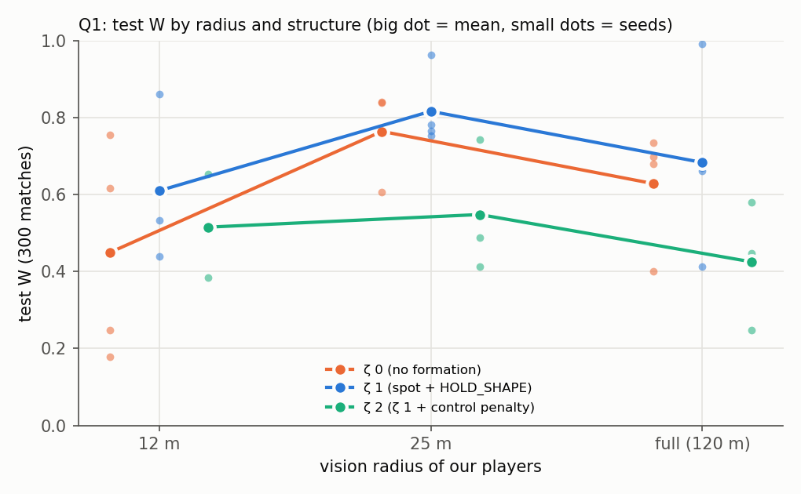
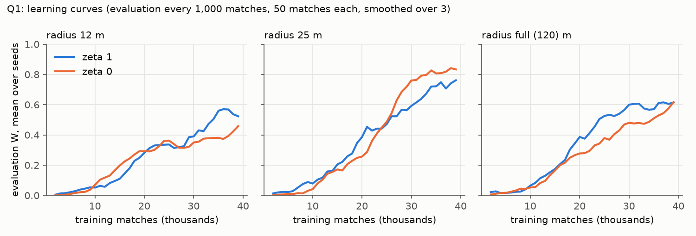
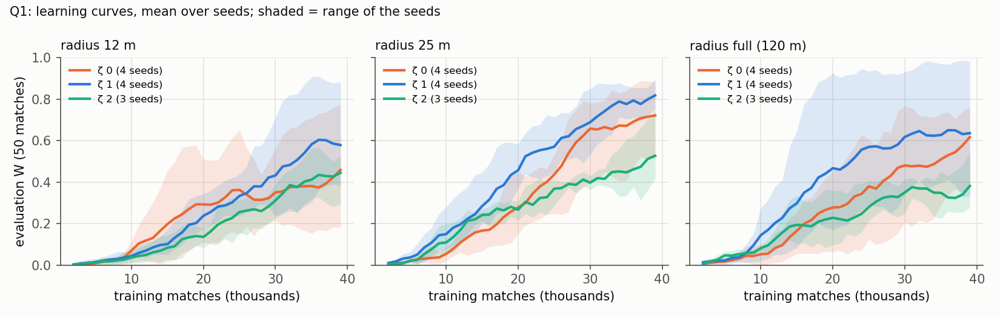

# Q1 report: Can formation structure compensate for limited vision?

All numbers are **means over the training seeds of a setting**. Each run is first measured on its own (300 test
matches, about ±0.03 in W), then the runs of a setting are averaged.

Blocks marked *(generated)* are filled by `football_adapt/runs/_tools/final_report.py` from the result files (run it
again after new results; it replaces only those blocks). Sections 3.2 to 4.4 come from the first 16 runs (seeds 0 and
42, plus 7 and 11 for ζ 0 at 12 m and full vision); the later seeds are in the generated tables.

## 1. Answer in short

| Q1 asks | Answer |
|---|---|
| Does giving the team a formation help? | **No, not measurably at this training budget.** Pooled over the three radii (12 runs a side), the formation spot changes test W by +0.09 ± 0.15, and the enforced formation by −0.12 ± 0.16 (numbers just below this table): both intervals include 0. If anything, enforcing the formation costs a little. **The training seed matters far more than structure**: one setting gives test W from 0.18 to 0.76 depending on the seed alone. |
| Does the benefit grow as `r` shrinks? | **No evidence for it.** The point estimates lean that way (B about +0.16 at 12 m, +0.05 at 25 m and with full vision), but each interval is ±0.2 to ±0.4 and includes 0, so the hypothesis is not supported. |
| Does the best formation depend on `r`? | **No, not measurably.** In single runs the best formation seemed to change with `r` (1-2-2 at 12 m, 1-3-1 at 25 m and full vision). With 4 seeds per formation at 12 m and a second 1-3-1 seed at 25 m that pattern disappeared: 2-2-1 is on top at 12 m and 25 m, and no difference between our formations has an interval that excludes 0 (§3.4). The extra seeds spread as widely as the formations differ (1-2-2 at 12 m: 0.80, 0.71, 0.38, 0.26). |

The benefit of structure, test W difference with a 95% interval over seeds *(generated)*:

<!-- AUTO:q1_answer -->
- **ζ 1 (formation spot) against ζ 0:** +0.16 ± 0.43 at 12 m (4 vs 4 seeds), +0.05 ± 0.18 at 25 m (4 vs 4 seeds), +0.05 ± 0.36 at full (120 m) (4 vs 4 seeds). No interval excludes 0: no difference can be claimed with these seeds.
- **ζ 2 (enforced formation) against ζ 0:** +0.07 ± 0.43 at 12 m (3 vs 4 seeds), -0.22 ± 0.35 at 25 m (3 vs 4 seeds), -0.20 ± 0.34 at full (120 m) (3 vs 4 seeds). No interval excludes 0: no difference can be claimed with these seeds.
- **Pooled over the radii, ζ 1 against ζ 0:** +0.09 ± 0.15 (12 vs 12 runs, each radius centred on its own mean). The interval includes 0: no effect of structure can be claimed.
- **Pooled over the radii, ζ 2 against ζ 0:** -0.12 ± 0.16 (9 vs 12 runs, each radius centred on its own mean). The interval includes 0: no effect of structure can be claimed.
- **Worst seed, ζ 1 vs ζ 0:** 12 m 0.44 vs 0.18, 25 m 0.75 vs 0.60, full (120 m) 0.41 vs 0.40.
<!-- /AUTO:q1_answer -->

Other findings:

- **25 m is the best radius.** The two structure levels average 0.76 and 0.82 at 25 m against 0.45 and 0.61 at 12 m. Full vision does not help and is no better than 25 m.
- **Seeds disagree because runs find different styles.** The good runs defend deep and counter-attack with fast passes; the bad ones drift into keeping the ball (§4.4). Across the first 16 runs, more possession goes with lower W (correlation −0.51).
- **The learned teams cope with limited vision much better than the hand-written team.** At 12 m the scripted team in our seat gets W 0.07; the learned teams average 0.45–0.61.
- **Every team has overfitted to the four opponent formations it trained against.** Against the never-seen 1-2-2 almost all score W 0.01–0.12.



## 2. What was run

### 2.1 Settings

| | radius 12 m | radius 25 m | full vision (120 m) |
|---|---|---|---|
| **ζ 0** (no formation) | seeds 0, 42, 7, 11 | 0, 42, 7, 11 | 0, 42, 7, 11 |
| **ζ 1** (formation spot + HOLD_SHAPE) | 0, 42, 7, 11 | 0, 42, 7, 11 | 0, 42, 7, 11 |
| **ζ 2** (ζ 1 + control penalty) | 0, 7, 11 | 0, 7, 11 | 0, 7, 11 |
| ζ 1 with our formation 1-3-1 / 1-2-2 | 0 | 0 | 0 |

40,000 training matches each. Seeds 0 and 42 were run first. Seeds 7 and 11 were added for every setting once it was
clear that seeds disagree by more than settings do. The generated tables list exactly which runs finished.

### 2.2 Setup

| Item | Choice |
|---|---|
| Game | 5-a-side, pitch 100 × 60 m, 1,200 steps per match |
| Our team | formation 2-2-1; one policy shared by all 5 players (MAPPO: MLP actor with 256 hidden units, centralized critic that sees the whole state) |
| Vision radius `r` | how far our players see **opponents**. The ball and teammates are always seen. The opponent always sees 25 m, whatever our `r` |
| zeta 0 | no formation spot in the observation and no HOLD_SHAPE. Off the ball a player has the 8 walking moves, STAY, GO_TO_BALL, TACKLE and SHADOW |
| zeta 1 | zeta 0 plus the player's formation spot in the observation (the spot moves with the attacking/defending shape) and the HOLD_SHAPE move (walk to the spot). No penalty for leaving the spot |
| zeta 2 | zeta 1 plus the control rating: tackle, pass and shot success drop with the player's distance from his formation spot, so the formation is enforced |
| Opponent | the scripted zonal team, formation drawn per match from 2-2-1, 2-1-2, 1-3-1, 3-1-1. 1-2-2 was left out on purpose: it is much the strongest formation (the scripted 2-2-1 gets W ≈ 0.1 against it) |
| Reward | goals ±100 for the whole team, plus potential-based shaping Φ = 10 × ball position (−1 at our goal line, +1 at theirs) + 30 × the ball carrier's chance to score (+ ours, − theirs). Potential-based shaping does not change which policy is best |
| Learning | PPO, γ = 0.99, λ = 0.95, value normalization, clip 0.2, 5 epochs, minibatch 1,024, learning rate 3e-4 (actor) / 1e-3 (critic), entropy 0.01, 48 games in parallel |
| Easy start | at first each opponent player acts at random half of the time. The randomness drops by 0.05 whenever we win 60% of 50 matches (rises when we win 40% or less). It first reached 0 after 9,000–30,000 matches. Runs that could not keep beating the full-strength opponent kept training against a slightly weakened one (randomness 0.05) |
| Evaluation | every 1,000 matches: 50 matches against the full-strength opponent on fixed seeds; a checkpoint is saved each time |
| Test | the checkpoint with the best evaluation is played on **300 new matches** (seeds never used before). This is the "test W" in this report |
| Formation check | the tested checkpoint plays 50 matches against each of the 5 formations; the scripted team plays the same matches in our seat as a yardstick |
| Play-style analysis | the tested checkpoint plays 100 more matches (25 against each training formation), recording where the players stand, who has the ball, and how the goals are made |

`W = Pr[win] + 0.5 × Pr[draw]`.

### 2.3 Changes from the plan in `questions.md`

| Plan | What was run | Why |
|---|---|---|
| ζ 0 against ζ 2 | ζ 0, **ζ 1 and ζ 2** | ζ 1 (information and the move, no penalty) separates the information from the enforcement |
| 3 formations of ours | **2-2-1** at every structure level; **1-3-1 and 1-2-2 at ζ 1, one seed each; later 4 seeds each at 12 m and 2 for 1-3-1 at 25 m** | compute; 1-3-1 is the best formation on average in Phase 0, 1-2-2 the maximin |
| 3 radii + full vision | **12, 25, full** | decision 12 |
| 3 seeds (5 on headline settings) | **4 seeds** (ζ 0, ζ 1), **3** (ζ 2), 1 (other formations) | |
| opponent formation random over all 5 | **4 formations** (no 1-2-2) | decision 10 |

## 3. Results

### 3.1 Win score *(generated)*

<!-- AUTO:q1_main -->
| setting | radius | seeds | test W, mean ± 95% interval over seeds | seed sd | each seed |
|---|---|---|---|---|---|
| ζ 0 (no formation) | 12 m | 4 | 0.45 ± 0.45 | 0.28 | s0 0.18, s11 0.62, s42 0.76, s7 0.25 |
| ζ 0 (no formation) | 25 m | 4 | 0.76 ± 0.18 | 0.11 | s0 0.84, s11 0.60, s42 0.84, s7 0.77 |
| ζ 0 (no formation) | full (120 m) | 4 | 0.63 ± 0.24 | 0.15 | s0 0.40, s11 0.68, s42 0.70, s7 0.73 |
| ζ 1 (spot + HOLD_SHAPE) | 12 m | 4 | 0.61 ± 0.29 | 0.18 | s0 0.60, s11 0.44, s42 0.53, s7 0.86 |
| ζ 1 (spot + HOLD_SHAPE) | 25 m | 4 | 0.82 ± 0.16 | 0.10 | s0 0.75, s11 0.78, s42 0.77, s7 0.96 |
| ζ 1 (spot + HOLD_SHAPE) | full (120 m) | 4 | 0.68 ± 0.38 | 0.24 | s0 0.67, s11 0.41, s42 0.66, s7 0.99 |
| ζ 2 (ζ 1 + control penalty) | 12 m | 3 | 0.52 ± 0.33 | 0.13 | s0 0.65, s11 0.39, s7 0.51 |
| ζ 2 (ζ 1 + control penalty) | 25 m | 3 | 0.55 ± 0.43 | 0.17 | s0 0.74, s11 0.41, s7 0.49 |
| ζ 2 (ζ 1 + control penalty) | full (120 m) | 3 | 0.42 ± 0.41 | 0.17 | s0 0.58, s11 0.45, s7 0.25 |
| ζ 1, our formation 1-3-1 | 12 m | 4 | 0.33 ± 0.41 | 0.26 | s0 0.27, s11 0.29, s42 0.07, s7 0.68 |
| ζ 1, our formation 1-3-1 | 25 m | 2 | 0.68 ± 3.41 | 0.38 | s0 0.95, s7 0.41 |
| ζ 1, our formation 1-3-1 | full (120 m) | 1 | 0.85 | – | s0 0.85 |
| ζ 1, our formation 1-2-2 | 12 m | 4 | 0.54 ± 0.42 | 0.26 | s0 0.80, s11 0.71, s42 0.38, s7 0.26 |
| ζ 1, our formation 1-2-2 | 25 m | 1 | 0.64 | – | s0 0.64 |
| ζ 1, our formation 1-2-2 | full (120 m) | 1 | 0.46 | – | s0 0.46 |


<!-- /AUTO:q1_main -->

**Benefit of the formation**, with 95% intervals over seeds (Welch):

<!-- AUTO:q1_B -->
| difference | 12 m | 25 m | full (120 m) |
|---|---|---|---|
| B₁(r) = W(ζ 1) − W(ζ 0) | +0.16 ± 0.43 | +0.05 ± 0.18 | +0.05 ± 0.36 |
| B₂(r) = W(ζ 2) − W(ζ 0) | +0.07 ± 0.43 | -0.22 ± 0.35 | -0.20 ± 0.34 |
| W(ζ 2) − W(ζ 1): the control penalty | -0.09 ± 0.31 | -0.27 ± 0.35 | -0.26 ± 0.39 |

- B₁(r) = W(ζ 1) − W(ζ 0) at 12 m: +0.16 [-0.27, +0.59]: **not distinguishable from 0** with these seeds.
- B₁(r) = W(ζ 1) − W(ζ 0) at 25 m: +0.05 [-0.13, +0.23]: **not distinguishable from 0** with these seeds.
- B₁(r) = W(ζ 1) − W(ζ 0) at full (120 m): +0.05 [-0.31, +0.42]: **not distinguishable from 0** with these seeds.
- B₂(r) = W(ζ 2) − W(ζ 0) at 12 m: +0.07 [-0.36, +0.49]: **not distinguishable from 0** with these seeds.
- B₂(r) = W(ζ 2) − W(ζ 0) at 25 m: -0.22 [-0.57, +0.14]: **not distinguishable from 0** with these seeds.
- B₂(r) = W(ζ 2) − W(ζ 0) at full (120 m): -0.20 [-0.54, +0.13]: **not distinguishable from 0** with these seeds.
- W(ζ 2) − W(ζ 1): the control penalty at 12 m: -0.09 [-0.40, +0.21]: **not distinguishable from 0** with these seeds.
- W(ζ 2) − W(ζ 1): the control penalty at 25 m: -0.27 [-0.62, +0.09]: **not distinguishable from 0** with these seeds.
- W(ζ 2) − W(ζ 1): the control penalty at full (120 m): -0.26 [-0.65, +0.13]: **not distinguishable from 0** with these seeds.
- B for ζ 1: B(12 m) − B(25 m) (does the benefit grow as r shrinks?): +0.11 [-0.40, +0.61]: **not distinguishable from 0** with these seeds.
- B for ζ 1: B(12 m) − B(full (120 m)) (does the benefit grow as r shrinks?): +0.10 [-0.50, +0.71]: **not distinguishable from 0** with these seeds.
- B for ζ 2: B(12 m) − B(25 m) (does the benefit grow as r shrinks?): +0.28 [-0.26, +0.83]: **not distinguishable from 0** with these seeds.
- B for ζ 2: B(12 m) − B(full (120 m)) (does the benefit grow as r shrinks?): +0.27 [-0.29, +0.83]: **not distinguishable from 0** with these seeds.
<!-- /AUTO:q1_B -->

### 3.2 Learning speed



| setting | evaluation W 0.3 first reached | W 0.5 | W 0.7 | mean W, last 10 evaluations | best checkpoint at |
|---|---|---|---|---|---|
| zeta 1, 12 m | 24k (2/2 seeds) | 36k (2/2) | never | 0.51 | 36k |
| zeta 0, 12 m | 17k (2/4) | 29k (2/4) | 36k (1/4) | 0.40 | 33k |
| zeta 1, 25 m | 20k (2/2) | 27k (2/2) | 35k (2/2) | 0.71 | 37k |
| zeta 0, 25 m | 23k (2/2) | 27k (2/2) | 30k (2/2) | 0.81 | 36k |
| zeta 1, full | 20k (2/2) | 25k (2/2) | never | 0.60 | 36k |
| zeta 0, full | 25k (4/4) | 30k (3/4) | 33k (2/4) | 0.53 | 37k |

"Reached" uses a moving average over 3 evaluations; the matches are averaged over the seeds that reached the level.

- All settings learn nothing useful for the first ~8,000 matches, while the opponent is still partly random and our team learns to defend.
- The team **with** a formation is ahead early at 25 m and at full vision. The team **without** one catches up and, at 25 m, overtakes it from about 26,000 matches.
- Learning comes in steps. In the first run (zeta 1, 25 m, seed 0) passing appeared at about 11,000 matches and the deep-defence-and-counter style at about 31,000; the other runs show similar jumps at different times.
- Most best checkpoints are late (33–37k) and several curves are still rising at 40,000 matches (zeta 0 at 12 m and at full vision most clearly). Longer training could move these numbers up.

### 3.3 Against each opponent formation

W over 50 matches against each formation, mean over seeds *(generated, all seeds)*:

<!-- AUTO:q1_vs -->
| setting | radius | seeds | 2-2-1 | 2-1-2 | 1-3-1 | 3-1-1 | 1-2-2 (never trained) |
|---|---|---|---|---|---|---|---|
| ζ 0 (no formation) | 12 m | 4 | 0.43 | 0.38 | 0.32 | 0.64 | 0.01 |
| ζ 0 (no formation) | 25 m | 4 | 0.80 | 0.76 | 0.45 | 0.89 | 0.07 |
| ζ 0 (no formation) | full (120 m) | 4 | 0.67 | 0.52 | 0.44 | 0.75 | 0.02 |
| ζ 1 (spot + HOLD_SHAPE) | 12 m | 4 | 0.64 | 0.57 | 0.44 | 0.79 | 0.05 |
| ζ 1 (spot + HOLD_SHAPE) | 25 m | 4 | 0.88 | 0.85 | 0.71 | 0.93 | 0.04 |
| ζ 1 (spot + HOLD_SHAPE) | full (120 m) | 4 | 0.76 | 0.77 | 0.38 | 0.83 | 0.24 |
| ζ 2 (ζ 1 + control penalty) | 12 m | 3 | 0.66 | 0.48 | 0.25 | 0.57 | 0.01 |
| ζ 2 (ζ 1 + control penalty) | 25 m | 3 | 0.64 | 0.54 | 0.22 | 0.62 | 0.01 |
| ζ 2 (ζ 1 + control penalty) | full (120 m) | 3 | 0.56 | 0.38 | 0.21 | 0.53 | 0.06 |
| ζ 1, our formation 1-3-1 | 12 m | 4 | 0.30 | 0.32 | 0.18 | 0.46 | 0.06 |
| ζ 1, our formation 1-3-1 | 25 m | 2 | 0.71 | 0.58 | 0.58 | 0.76 | 0.22 |
| ζ 1, our formation 1-3-1 | full (120 m) | 1 | 0.72 | 0.96 | 0.72 | 0.94 | 0.41 |
| ζ 1, our formation 1-2-2 | 12 m | 4 | 0.66 | 0.45 | 0.34 | 0.70 | 0.08 |
| ζ 1, our formation 1-2-2 | 25 m | 1 | 0.58 | 0.74 | 0.24 | 0.80 | 0.02 |
| ζ 1, our formation 1-2-2 | full (120 m) | 1 | 0.46 | 0.73 | 0.01 | 0.47 | 0.00 |
<!-- /AUTO:q1_vs -->

The scripted team in our seat, same matches (zeta does not apply to it):

| scripted team | 2-2-1 | 2-1-2 | 1-3-1 | 3-1-1 | 1-2-2 | mean over the 4 training formations |
|---|---|---|---|---|---|---|
| radius 12 m | 0.07 | 0.11 | 0.02 | 0.10 | 0.09 | **0.07** |
| radius 25 m | 0.57 | 0.52 | 0.27 | 0.43 | 0.21 | **0.45** |
| full vision | 0.62 | 0.66 | 0.32 | 0.55 | 0.31 | **0.54** |

- **1-3-1 is the hardest training opponent** for every team, learned or scripted.
- **Limited vision breaks the scripted team but not the learned ones.** The scripted team falls from 0.45 to 0.07 when its radius drops from 25 m to 12 m. The learned teams fall from about 0.8 to about 0.5.
- **Overfitting:** the teams lose almost every match against 1-2-2, the one formation they never met. A team trained only against 1-2-2 (Q2 run `q2/f122_r25_z0`) beats it in 99% of matches, so 1-2-2 is not unbeatable: our Q1 teams simply never learned it.

### 3.4 Our formation by radius *(generated)*

<!-- AUTO:q1_form -->
| radius | 2-2-1 | 1-3-1 | 1-2-2 | best |
|---|---|---|---|---|
| 12 m | 0.61 (n=4) | 0.33 (n=4) | 0.54 (n=4) | 2-2-1 |
| 25 m | 0.82 (n=4) | 0.68 (n=2) | 0.64 (n=1) | 2-2-1 |
| full (120 m) | 0.68 (n=4) | 0.85 (n=1) | 0.46 (n=1) | 1-3-1 |
<!-- /AUTO:q1_form -->

Which of our formations is best at each radius, tested over seeds *(generated)*:

<!-- AUTO:q1_form_concl -->
- **12 m:** 2-2-1 is best (W 0.61), ahead of 1-2-2 by +0.07 ± 0.40 (4 vs 4 seeds, not distinguishable from 0) and of 1-3-1 by +0.28 ± 0.40 (4 vs 4 seeds, not distinguishable from 0).
- **25 m:** 2-2-1 is best (W 0.82), ahead of 1-3-1 by +0.14 ± 3.31 (4 vs 2 seeds, not distinguishable from 0) and of 1-2-2 by +0.18 (4 vs 1 seeds, no interval).
- **full (120 m):** 1-3-1 is best (W 0.85), ahead of 2-2-1 by +0.17 (1 vs 4 seeds, no interval) and of 1-2-2 by +0.38 (1 vs 1 seed, no interval).

No difference between our formations is distinguishable from 0 with these seeds, so a dependence of the best formation on r cannot be claimed.
<!-- /AUTO:q1_form_concl -->

<!-- AUTO:q1_curves -->

<!-- /AUTO:q1_curves -->

## 4. How the teams play

### 4.1 Who has the ball and how the defence works

From the play-style analysis (100 matches per run, mean over seeds):

| setting | ball: ours / theirs / in the air | they hold it in our half | their passes | their shots | our tackles (won) | interceptions |
|---|---|---|---|---|---|---|
| zeta 1, 12 m | 13% / 55% / 33% | 40% | 66 | 4.7 | 15.8 (8.9) | 0.9 |
| zeta 0, 12 m | 20% / 51% / 29% | 40% | 66 | 4.3 | 13.8 (8.1) | 0.7 |
| zeta 1, 25 m | 13% / 58% / 29% | 44% | 70 | 3.4 | 17.0 (9.8) | 0.6 |
| zeta 0, 25 m | 13% / 57% / 30% | 44% | 54 | 2.1 | 13.0 (7.6) | 0.7 |
| zeta 1, full | 24% / 50% / 26% | 35% | 48 | 3.0 | 13.6 (8.0) | 0.4 |
| zeta 0, full | 32% / 42% / 26% | 29% | 52 | 3.6 | 14.9 (8.7) | 0.6 |

Every team lets the opponent have the ball most of the time: the opponent holds it 42–58% of the match, mostly in our half. Our teams win it back almost only by **tackling** (8–10 won a match); interceptions are rare.

- **Teams at 12 m and 25 m defend deep.** They have the ball only 13% of the time, let the opponent pass the ball around in our half (54–70 passes a match), and wait for a tackle.
- **The best team (zeta 0, 25 m) also lets the opponent shoot least** (2.1 shots a match) and concedes least (1.5 goals).
- **Full-vision teams keep the ball** two to three times as long (24–32%) and let the opponent into our half less.

### 4.2 How the goals are made

| setting | goals started in own third | goals with 2+ passes | steps from winning the ball to the goal (median) | goals within 60 steps |
|---|---|---|---|---|
| zeta 1, 12 m | 85% | 83% | 38 | 96% |
| zeta 0, 12 m | 87% | 93% | 34 | 99% |
| zeta 1, 25 m | 85% | 91% | 34 | 98% |
| zeta 0, 25 m | 78% | 92% | 32 | 84% |
| zeta 1, full | 73% | 46% | 30 | 99% |
| zeta 0, full | 66% | 55% | 32 | 96% |

| setting | passes completed | pass completion | through balls | shots | chance per shot | turnovers |
|---|---|---|---|---|---|---|
| zeta 1, 12 m | 13.9 | 89% | 7.5 | 3.7 | 0.82 | 10.3 |
| zeta 0, 12 m | 12.7 | 83% | 6.8 | 2.9 | 0.68 | 10.1 |
| zeta 1, 25 m | 14.1 | 96% | 10.4 | 5.0 | 0.85 | 8.6 |
| zeta 0, 25 m | 14.7 | 92% | 11.0 | 5.7 | 0.83 | 4.8 |
| zeta 1, full | 11.6 | 94% | 7.2 | 4.9 | 0.60 | 6.5 |
| zeta 0, full | 14.3 | 98% | 7.4 | 4.3 | 0.70 | 8.6 |

(Passes to turnovers: from the 300 test matches, per match.)

- **Fast counter-attacks.** At 12 m and 25 m almost every goal is a fast counter-attack. The ball is won in our own third, two or more quick passes (often a through ball into space) follow, and a goal comes about 30–40 steps later. The shots are very good: an average chance of 0.82–0.85 to score.
- **Fewer passes with full vision.** Only half of the full-vision teams' goals involve two or more passes, and their shots are worse (chance 0.60–0.70). They shoot more often from positions the counter-attacking teams would not shoot from.
- **The best team loses the ball least.** zeta 0 at 25 m loses it only 4.8 times a match, against 6.5–10.3 for the others.
- **A small radius makes passing riskier.** At 12 m our pass filter offers passes that look safe because the player cannot see the defender who will intercept. Pass completion drops (83–89%) and turnovers rise (about 10 a match).

### 4.3 Where the players stand

| setting | team depth defending | team depth attacking | spread between teammates (m) | distance from formation spot (m) |
|---|---|---|---|---|
| zeta 1, 12 m | 0.40 | 0.41 | 32.6 | 16.8 |
| zeta 0, 12 m | 0.40 | 0.40 | 32.1 | 21.4 |
| zeta 1, 25 m | 0.41 | 0.42 | 30.5 | 16.8 |
| zeta 0, 25 m | 0.39 | 0.42 | 33.6 | 22.2 |
| zeta 1, full | 0.40 | 0.41 | 27.1 | 19.6 |
| zeta 0, full | 0.43 | 0.43 | 27.3 | 21.9 |

Depth = mean x of our 5 players as a fraction of the pitch length (0 = our goal line, 1 = theirs). Spread = mean distance between two teammates. The formation spot is measured for zeta 0 too, although those teams are never told where it is.

- **Every team plays deep.** The team's centre stays at about 40% of the pitch, whether it has the ball or not. It does not push up when attacking, because its attacks are fast breaks by one or two players.
- **The formation spot is a guide, not a rule.** With zeta 1 the players stay about 5 m closer to their spot (17 m against 21–22 m), but still far from it.
- **Without being told, zeta 0 teams still keep a shape:** they stand at a similar depth and spread as zeta 1 teams. The positions they learn are different from the textbook formation but not chaotic.
- **Full-vision teams stand closer together** (27 m against 30–34 m). This is the **opposite** of the plan's hypothesis that spread would be larger at large radius. Seeing everyone, the team keeps a compact passing shape.

### 4.4 Why zeta 0 is unreliable at 12 m and with full vision

The seeds of one setting can learn different styles:

| setting | style found | seeds | mean possession | mean test W |
|---|---|---|---|---|
| zeta 0, 12 m | deep defence + counter-attack | 2 of 4 | 10% | 0.69 |
| zeta 0, 12 m | keeping the ball | 2 of 4 | 28% | 0.22 |
| zeta 0, full | the runs that worked | 3 of 4 | 26% | 0.70 |
| zeta 0, full | the most possession-heavy run | 1 of 4 | 41% | 0.40 |

The setting does not decide the style, the run does. The two failed runs at 12 m also never got the easy start out of the way: after 20,000 matches they still trained against a slightly weakened opponent 80–90% of the time, because they could not keep beating the full-strength one. At 12 m without a formation, a run is a coin flip: half find the counter-attack and play well, half drift into a possession game that a team seeing only 12 m cannot make work. With the formation spot (zeta 1) the worst seed at 12 m still reached W 0.44 (against 0.18 and 0.25 for the two failed zeta 0 seeds), so at 12 m the formation seems to protect against the worst outcome; over all radii, though, the seed spread is no smaller with it (§5, conclusion 2). At 25 m both levels find the counter-attack every time, and the team without a formation plays it best.

## 5. Conclusions for Q1

1. **Structure does not make the team better at this training budget.** Pooled over the radii the formation spot adds +0.09 ± 0.15 W (§1). The benefit B(r) is small against the seed spread at every radius (§3.1). A positive B(12 m) of about +0.16 fits the hypothesis, but four seeds cannot separate it from 0.
2. **The worst run is better with the formation at limited vision, but the spread is not.** The worst ζ 1 seed beats the worst ζ 0 seed by 0.26 W at 12 m (0.44 against 0.18) and by 0.15 at 25 m (0.75 against 0.60). With full vision there is no such effect (0.41 against 0.40). Over all 12 runs a side the seed spread is the same with and without the formation (SD 0.17 and 0.18, Levene p 0.68), so this is an observation on single runs, not a tested effect. Runs without a formation more often settle into a possession style that limited vision cannot support (§4.4).
3. **The hypothesis "structure helps more at small r" is not supported by the data**: the point estimates fit it (B about +0.16 at 12 m, +0.05 at 25 m and with full vision), but every interval includes 0 (§3.1).
4. **The hypothesis "spread is larger at large r" is not supported.** Full-vision teams are the most compact (§4.3).
5. **More vision is not always better.** 25 m is the best radius at both structure levels.
6. **Seed variance is a result in itself.** One setting can give test W anywhere from about 0.2 to 0.9, so claims about structure need several seeds. A comparison with one seed per setting would have shown a clean +0.37 benefit at 12 m (seed 0 alone).
7. **All teams overfit to the four training formations.**
8. <!-- AUTO:q1_z2_concl -->
**Enforcing the formation (ζ 2) on top of the spot** changes test W against ζ 0 by +0.07 ± 0.43 at 12 m, -0.22 ± 0.35 at 25 m, -0.20 ± 0.34 at full (120 m) (3 ζ 2 seeds against 4 ζ 0 seeds). No interval excludes 0: the control penalty does not change the result by more than the seeds do.
<!-- /AUTO:q1_z2_concl -->

The generated blocks in §3.1 and §3.4 add ζ 2 (the enforced formation) and our other formations. Read their verdict lines: "interval excludes 0" is a finding, "not distinguishable" is not.

## 6. Limitations

- **Seeds.** 3–4 seeds per setting give 95% intervals of about ±0.15 (25 m) to ±0.45 (12 m) on a setting's W. Differences smaller than that should not be read as real. The 1-3-1 / 1-2-2 teams have 4 seeds at 12 m, 2 (1-3-1) or 1 (1-2-2) at 25 m and 1 with full vision.
- **One opponent.** All results are against one scripted opponent whose behaviour is fixed. The counter-attack style partly exploits how it attacks: it commits players forward and loses the ball in our half. Against 1-2-2 every team fails.
- **Training length.** Several settings were still improving at 40,000 matches, so the ranking could change with longer training.
- **Best-checkpoint pick.** The best of 40 evaluations (50 matches each) is chosen, which flatters its evaluation W. The test W on 300 new matches is unbiased and is what this report uses.
- **Sections 3.2 and 4 use the first 16 runs** (style analysis and learning-speed table); the later seeds are only in the generated tables and figures.

## 7. Files and how to reproduce

| What | Where |
|---|---|
| Runs | `football_adapt/runs/q1/<zeta>_<radius>/s<seed>/` (old names v1–v6 in `runs/q1/README.md`) |
| Per run | `ckpts/` (a checkpoint per evaluation), `result.json` (test), `vs_formations.txt`, `log.jsonl`, `config.json`, `train.log` |
| Index of all runs | `runs/q1/README.md` (`python runs/_tools/index.py q1`) |
| Averages and learning speed | `runs/q1/summary.json` (`python runs/_tools/q1_summary.py`) |
| Play-style data | `runs/q1/style.jsonl` (`runs/_tools/style_stats.py`, run on a server) |
| Tables and figures in this report | `runs/_tools/q1_tables.py`, `runs/_tools/q1_plots.py` → `docs/img/q1/` |

Training one run (from `football_adapt/`, here zeta 0, radius 25, seed 42):

```bash
bash runs/_tools/run_then_check.sh q1/z0_r25/s42 --recipe configs/study.yaml --our-formation 2-2-1 \
     --opp-formations 2-2-1,2-1-2,1-3-1,3-1-1 --radius 25 --zeta 0 --seed 42 --opp-eps-start 0.5 \
     --workers --n-envs 48 --batch-size 1024 --torch-threads 8 --matches 40000 --eval-every 1000 \
     --eval-matches 50 --eval-procs 50 --test-matches 300
```

Watching a team (best checkpoint of zeta 0, radius 25, seed 0):

```bash
../.venv/bin/python -m scripts.pygame_render --ckpt runs/q1/z0_r25/s0/ckpts/m038016.pt
```
