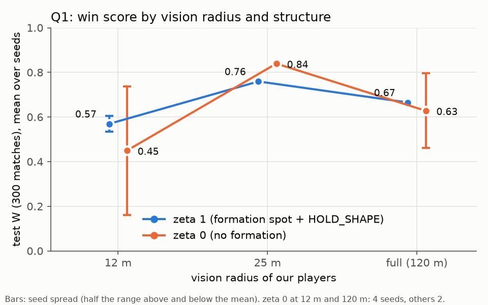
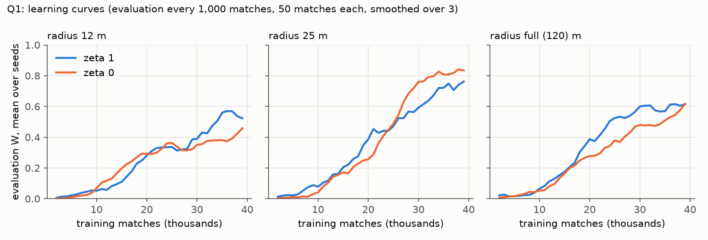

# Q1 report: Can formation structure compensate for limited vision?

All numbers are **means over the training seeds of a setting**. Each run is first measured on its own (300 test
matches, about ±0.03 in W), then the runs of a setting are averaged.

## 1. Answer in short

| Q1 asks | Answer |
|---|---|
| Does giving the team a formation help? | **It depends on the vision radius.** At 12 m it helps: W 0.57 against 0.45, and every seed gives the same result. At 25 m it hurts: the team without a formation is the best of all six settings (0.84 against 0.76, both steady over seeds). With full vision it makes little difference on average (0.67 against 0.63). |
| Does the benefit grow as `r` shrinks? | **From 25 m to 12 m, yes:** B(r) = W(zeta 1) − W(zeta 0) goes from −0.08 to +0.12. Full vision does not fit a simple trend (+0.04). The clearest effect of the formation is **reliability**: with a formation, runs of the same setting agree within 0.07 W at every radius; without one, the result at 12 m and at full vision depends on which style a run happens to discover (seed spread 0.58 and 0.33). |
| Does the best formation depend on `r`? | **Not answered.** Our formation was fixed to 2-2-1 (decision 11). |

Other findings:

- **25 m is the best radius at both structure levels.** 12 m costs mostly through defence. Full vision does not help and is slightly worse than 25 m.
- **The learned teams cope with limited vision much better than the hand-written team.** At 12 m the scripted team in our seat gets W 0.07; the learned teams get 0.45–0.57.
- **Every team has overfitted to the four opponent formations it trained against.** Against the never-seen 1-2-2 all score W 0.01–0.12.
- **How a team plays matters more than any single setting.** The best teams learned to defend deep and counter-attack with fast passes; teams that drifted into keeping the ball did worse. Across all 16 runs, more possession goes with lower W (correlation −0.51).



## 2. What was run

### 2.1 Settings

| | radius 12 m | radius 25 m | full vision (120 m) |
|---|---|---|---|
| **zeta 1** (formation spot + HOLD_SHAPE) | 2 seeds | 2 seeds | 2 seeds |
| **zeta 0** (no formation) | 4 seeds | 2 seeds | 4 seeds |

Seeds 0 and 42 for every setting. The two zeta 0 settings whose first two seeds disagreed got seeds 7 and 11 as well.
16 runs in total, 40,000 training matches each.

### 2.2 Setup

| Item | Choice |
|---|---|
| Game | 5-a-side, pitch 100 × 60 m, 1,200 steps per match |
| Our team | formation 2-2-1; one policy shared by all 5 players (MAPPO: MLP actor with 256 hidden units, centralized critic that sees the whole state) |
| Vision radius `r` | how far our players see **opponents**. The ball and teammates are always seen. The opponent always sees 25 m, whatever our `r` |
| zeta 0 | no formation spot in the observation and no HOLD_SHAPE. Off the ball a player has the 8 walking moves, STAY, GO_TO_BALL, TACKLE and SHADOW |
| zeta 1 | zeta 0 plus the player's formation spot in the observation (the spot moves with the attacking/defending shape) and the HOLD_SHAPE move (walk to the spot). No penalty for leaving the spot (that would be zeta 2, not studied) |
| Opponent | the scripted zonal team, formation drawn per match from 2-2-1, 2-1-2, 1-3-1, 3-1-1. 1-2-2 was left out on purpose: it is much the strongest formation (the scripted 2-2-1 gets W ≈ 0.1 against it) |
| Reward | goals ±100 for the whole team, plus potential-based shaping Φ = 10 × ball position (−1 at our goal line, +1 at theirs) + 30 × the ball carrier's chance to score (+ ours, − theirs). Potential-based shaping does not change which policy is best |
| Learning | PPO, γ = 0.99, λ = 0.95, value normalization, clip 0.2, 5 epochs, minibatch 1,024, learning rate 3e-4 (actor) / 1e-3 (critic), entropy 0.01, 48 games in parallel |
| Easy start | at first each opponent player acts at random half of the time. The randomness drops by 0.05 whenever we win 60% of 50 matches (rises when we win 40% or less). It first reached 0 after 9,000–30,000 matches. Runs that could not keep beating the full-strength opponent kept training against a slightly weakened one (randomness 0.05) |
| Evaluation | every 1,000 matches: 50 matches against the full-strength opponent on fixed seeds; a checkpoint is saved each time |
| Test | the checkpoint with the best evaluation is played on **300 new matches** (seeds never used before). This is the "test W" in this report |
| Formation check | the tested checkpoint plays 50 matches against each of the 5 formations; the scripted team plays the same matches in our seat as a yardstick |
| Play-style analysis | the tested checkpoint plays 100 more matches (25 against each training formation), recording where the players stand, who has the ball, and how the goals are made |

`W = Pr[win] + 0.5 × Pr[draw]`.

### 2.3 Changes from the plan in `questions.md`

| Plan | What was run | Why |
|---|---|---|
| zeta 0 against zeta 2 | zeta 0 against **zeta 1** | decision 9: no control-rating penalty, so only the information and the move differ |
| 3 formations of ours | **2-2-1 only** | decision 11 |
| 3 radii + full vision | **12, 25, full** | decision 12 |
| 3 seeds (5 on headline settings) | **2 seeds**, 4 where the first two disagreed | decided after the seed results were explained |
| opponent formation random over all 5 | **4 formations** (no 1-2-2) | decision 10 |

## 3. Results

### 3.1 Win score

| setting | seeds | test W | seed spread | win | draw | goals for | goals against |
|---|---|---|---|---|---|---|---|
| zeta 1, 12 m | 2 | **0.57** | 0.07 | 51% | 12% | 3.2 | 2.8 |
| zeta 0, 12 m | 4 | **0.45** | 0.58 | 40% | 9% | 2.6 | 2.6 |
| zeta 1, 25 m | 2 | **0.76** | 0.01 | 73% | 6% | 4.5 | 2.1 |
| zeta 0, 25 m | 2 | **0.84** | 0.00 | 80% | 8% | 5.3 | 1.5 |
| zeta 1, full | 2 | **0.67** | 0.01 | 61% | 10% | 4.2 | 1.7 |
| zeta 0, full | 4 | **0.63** | 0.33 | 58% | 9% | 3.5 | 2.0 |

Seed spread = best seed minus worst seed. Goals are per match.

**Benefit of the formation, B(r) = W(zeta 1) − W(zeta 0):**

| radius | B(r) | How sure |
|---|---|---|
| 12 m | **+0.12** | The mean gap is smaller than the zeta 0 seed spread (0.58), so the size is uncertain. What is certain: zeta 1 always gives about 0.57, zeta 0 gives anything from 0.2 to 0.8. |
| 25 m | **−0.08** | Solid: both settings are almost identical across seeds (spread 0.01 and 0.00). |
| full | **+0.04** | Within the zeta 0 seed spread (0.33): no clear difference. |

### 3.2 Learning speed



| setting | evaluation W 0.3 first reached | W 0.5 | W 0.7 | mean W, last 10 evaluations | best checkpoint at |
|---|---|---|---|---|---|
| zeta 1, 12 m | 24k (2/2 seeds) | 36k (2/2) | never | 0.51 | 36k |
| zeta 0, 12 m | 17k (2/4) | 29k (2/4) | 36k (1/4) | 0.40 | 33k |
| zeta 1, 25 m | 20k (2/2) | 27k (2/2) | 35k (2/2) | 0.71 | 37k |
| zeta 0, 25 m | 23k (2/2) | 27k (2/2) | 30k (2/2) | 0.81 | 36k |
| zeta 1, full | 20k (2/2) | 25k (2/2) | never | 0.60 | 36k |
| zeta 0, full | 25k (4/4) | 30k (3/4) | 33k (2/4) | 0.53 | 37k |

"Reached" uses a moving average over 3 evaluations; the matches are averaged over the seeds that reached the level.

- All settings learn nothing useful for the first ~8,000 matches, while the opponent is still partly random and our team learns to defend.
- The team **with** a formation is ahead early at 25 m and at full vision. The team **without** one catches up and, at 25 m, overtakes it from about 26,000 matches.
- Learning comes in steps. In the first run (zeta 1, 25 m, seed 0) passing appeared at about 11,000 matches and the deep-defence-and-counter style at about 31,000; the other runs show similar jumps at different times.
- Most best checkpoints are late (33–37k) and several curves are still rising at 40,000 matches (zeta 0 at 12 m and at full vision most clearly). Longer training could move these numbers up.

### 3.3 Against each opponent formation

W over 50 matches against each formation, mean over seeds:

| setting | 2-2-1 | 2-1-2 | 1-3-1 | 3-1-1 | 1-2-2 (never trained) |
|---|---|---|---|---|---|
| zeta 1, 12 m | 0.66 | 0.49 | 0.33 | 0.82 | 0.04 |
| zeta 0, 12 m | 0.43 | 0.38 | 0.32 | 0.64 | 0.01 |
| zeta 1, 25 m | 0.82 | 0.76 | 0.61 | 0.91 | 0.03 |
| zeta 0, 25 m | 0.94 | 0.90 | 0.62 | 0.85 | 0.12 |
| zeta 1, full | 0.78 | 0.81 | 0.20 | 0.90 | 0.03 |
| zeta 0, full | 0.67 | 0.52 | 0.44 | 0.75 | 0.02 |

The scripted team in our seat, same matches (zeta does not apply to it):

| scripted team | 2-2-1 | 2-1-2 | 1-3-1 | 3-1-1 | 1-2-2 | mean over the 4 training formations |
|---|---|---|---|---|---|---|
| radius 12 m | 0.07 | 0.11 | 0.02 | 0.10 | 0.09 | **0.07** |
| radius 25 m | 0.57 | 0.52 | 0.27 | 0.43 | 0.21 | **0.45** |
| full vision | 0.62 | 0.66 | 0.32 | 0.55 | 0.31 | **0.54** |

- **1-3-1 is the hardest training opponent** for every team, learned or scripted.
- **With a formation and full vision the team is weak against 1-3-1** (0.20). Its possession game cannot get through a three-man midfield.
- **Limited vision breaks the scripted team but not the learned ones.** The scripted team falls from 0.45 to 0.07 when its radius drops from 25 m to 12 m. The learned teams fall from about 0.8 to about 0.5.
- **Overfitting:** every team loses almost every match against 1-2-2, the one formation it never met. A team trained only against 1-2-2 (Q2 run `q2/f122_r25_z0`) beats it in 99% of matches, so 1-2-2 is not unbeatable: our Q1 teams simply never learned it.

## 4. How the teams play

### 4.1 Who has the ball and how the defence works

From the play-style analysis (100 matches per run, mean over seeds):

| setting | ball: ours / theirs / in the air | they hold it in our half | their passes | their shots | our tackles (won) | interceptions |
|---|---|---|---|---|---|---|
| zeta 1, 12 m | 13% / 55% / 33% | 40% | 66 | 4.7 | 15.8 (8.9) | 0.9 |
| zeta 0, 12 m | 20% / 51% / 29% | 40% | 66 | 4.3 | 13.8 (8.1) | 0.7 |
| zeta 1, 25 m | 13% / 58% / 29% | 44% | 70 | 3.4 | 17.0 (9.8) | 0.6 |
| zeta 0, 25 m | 13% / 57% / 30% | 44% | 54 | 2.1 | 13.0 (7.6) | 0.7 |
| zeta 1, full | 24% / 50% / 26% | 35% | 48 | 3.0 | 13.6 (8.0) | 0.4 |
| zeta 0, full | 32% / 42% / 26% | 29% | 52 | 3.6 | 14.9 (8.7) | 0.6 |

Every team lets the opponent have the ball most of the time: the opponent holds it 42–58% of the match, mostly in our half. Our teams win it back almost only by **tackling** (8–10 won a match); interceptions are rare.

- **Teams at 12 m and 25 m defend deep.** They have the ball only 13% of the time, let the opponent pass the ball around in our half (54–70 passes a match), and wait for a tackle.
- **The best team (zeta 0, 25 m) also lets the opponent shoot least** (2.1 shots a match) and concedes least (1.5 goals).
- **Full-vision teams keep the ball** two to three times as long (24–32%) and let the opponent into our half less.

### 4.2 How the goals are made

| setting | goals started in own third | goals with 2+ passes | steps from winning the ball to the goal (median) | goals within 60 steps |
|---|---|---|---|---|
| zeta 1, 12 m | 85% | 83% | 38 | 96% |
| zeta 0, 12 m | 87% | 93% | 34 | 99% |
| zeta 1, 25 m | 85% | 91% | 34 | 98% |
| zeta 0, 25 m | 78% | 92% | 32 | 84% |
| zeta 1, full | 73% | 46% | 30 | 99% |
| zeta 0, full | 66% | 55% | 32 | 96% |

| setting | passes completed | pass completion | through balls | shots | chance per shot | turnovers |
|---|---|---|---|---|---|---|
| zeta 1, 12 m | 13.9 | 89% | 7.5 | 3.7 | 0.82 | 10.3 |
| zeta 0, 12 m | 12.7 | 83% | 6.8 | 2.9 | 0.68 | 10.1 |
| zeta 1, 25 m | 14.1 | 96% | 10.4 | 5.0 | 0.85 | 8.6 |
| zeta 0, 25 m | 14.7 | 92% | 11.0 | 5.7 | 0.83 | 4.8 |
| zeta 1, full | 11.6 | 94% | 7.2 | 4.9 | 0.60 | 6.5 |
| zeta 0, full | 14.3 | 98% | 7.4 | 4.3 | 0.70 | 8.6 |

(Passes to turnovers: from the 300 test matches, per match.)

- **Fast counter-attacks.** At 12 m and 25 m almost every goal is a fast counter-attack. The ball is won in our own third, two or more quick passes (often a through ball into space) follow, and a goal comes about 30–40 steps later. The shots are very good: an average chance of 0.82–0.85 to score.
- **Fewer passes with full vision.** Only half of the full-vision teams' goals involve two or more passes, and their shots are worse (chance 0.60–0.70). They shoot more often from positions the counter-attacking teams would not shoot from.
- **The best team loses the ball least.** zeta 0 at 25 m loses it only 4.8 times a match, against 6.5–10.3 for the others.
- **A small radius makes passing riskier.** At 12 m our pass filter offers passes that look safe because the player cannot see the defender who will intercept. Pass completion drops (83–89%) and turnovers rise (about 10 a match).

### 4.3 Where the players stand

| setting | team depth defending | team depth attacking | spread between teammates (m) | distance from formation spot (m) |
|---|---|---|---|---|
| zeta 1, 12 m | 0.40 | 0.41 | 32.6 | 16.8 |
| zeta 0, 12 m | 0.40 | 0.40 | 32.1 | 21.4 |
| zeta 1, 25 m | 0.41 | 0.42 | 30.5 | 16.8 |
| zeta 0, 25 m | 0.39 | 0.42 | 33.6 | 22.2 |
| zeta 1, full | 0.40 | 0.41 | 27.1 | 19.6 |
| zeta 0, full | 0.43 | 0.43 | 27.3 | 21.9 |

Depth = mean x of our 5 players as a fraction of the pitch length (0 = our goal line, 1 = theirs). Spread = mean distance between two teammates. The formation spot is measured for zeta 0 too, although those teams are never told where it is.

- **Every team plays deep.** The team's centre stays at about 40% of the pitch, whether it has the ball or not. It does not push up when attacking, because its attacks are fast breaks by one or two players.
- **The formation spot is a guide, not a rule.** With zeta 1 the players stay about 5 m closer to their spot (17 m against 21–22 m), but still far from it.
- **Without being told, zeta 0 teams still keep a shape:** they stand at a similar depth and spread as zeta 1 teams. The positions they learn are different from the textbook formation but not chaotic.
- **Full-vision teams stand closer together** (27 m against 30–34 m). This is the **opposite** of the plan's hypothesis that spread would be larger at large radius. Seeing everyone, the team keeps a compact passing shape.

### 4.4 Why zeta 0 is unreliable at 12 m and with full vision

The seeds of one setting can learn different styles:

| setting | style found | seeds | mean possession | mean test W |
|---|---|---|---|---|
| zeta 0, 12 m | deep defence + counter-attack | 2 of 4 | 10% | 0.69 |
| zeta 0, 12 m | keeping the ball | 2 of 4 | 28% | 0.22 |
| zeta 0, full | the runs that worked | 3 of 4 | 26% | 0.70 |
| zeta 0, full | the most possession-heavy run | 1 of 4 | 41% | 0.40 |

The setting does not decide the style, the run does. The two failed runs at 12 m also never got the easy start out of the way: after 20,000 matches they still trained against a slightly weakened opponent 80–90% of the time, because they could not keep beating the full-strength one. At 12 m without a formation, a run is a coin flip: half find the counter-attack and play well, half drift into a possession game that a team seeing only 12 m cannot make work. With the formation spot (zeta 1) every seed ended up with the same style and almost the same W, so the formation acts as a **stabiliser**: it removes the bad outcomes rather than raising the best ones. At 25 m both levels find the counter-attack every time, and the team without a formation plays it best.

## 5. Conclusions for Q1

1. **The formation does not make the team better in general, but it makes learning reliable when vision is poor.** At 12 m it raises the average (0.57 against 0.45) by preventing the runs that fail. With good vision (25 m) it costs about 0.08 W: the team finds better positions by itself.
2. **The hypothesis "structure helps more at small r" is supported** from 25 m to 12 m (B goes from −0.08 to +0.12), mainly through reliability.
3. **The hypothesis "spread is larger at large r" is not supported.** Full-vision teams are the most compact.
4. **More vision is not always better.** 25 m beats full vision at both structure levels. Full vision leads teams into a possession style that is weaker against this opponent, especially against 1-3-1.
5. **Learning copes with limited vision far better than hand-written rules** (at 12 m: 0.45–0.57 against 0.07).
6. **All teams overfit to the four training formations.** Robustness to new opponent formations is not something Q1's training gives.

## 6. Limitations

- **Seeds.** Two seeds per setting (four for two settings). Differences smaller than about 0.1 W should not be read as real, and B(12 m) and B(full) are within the zeta 0 seed spread.
- **Structure level.** zeta 1 only adds information and a move; the control-rating penalty (zeta 2) was not studied, so these results do not cover a formation that is *enforced*.
- **Our formation.** Only 2-2-1 was used, so the "best formation by radius" part of Q1 is open.
- **One opponent.** All results are against one scripted opponent whose behaviour is fixed; the counter-attack style partly exploits how it attacks (it commits players forward and loses the ball in our half). Against 1-2-2 every team fails.
- **Training length.** Several settings were still improving at 40,000 matches, so the ranking could change with longer training, especially for zeta 0 at 12 m and with full vision.
- **Best-checkpoint pick.** The best of 40 evaluations (50 matches each) is chosen, which flatters its evaluation W. The test W on 300 new matches is unbiased and is what this report uses; it is on average 0.07 below the evaluation W of the same checkpoint.

## 7. Files and how to reproduce

| What | Where |
|---|---|
| Runs | `football_adapt/runs/q1/<zeta>_<radius>/s<seed>/` (old names v1–v6 in `runs/q1/README.md`) |
| Per run | `ckpts/` (a checkpoint per evaluation), `result.json` (test), `vs_formations.txt`, `log.jsonl`, `config.json`, `train.log` |
| Index of all runs | `runs/q1/README.md` (`python runs/_tools/index.py q1`) |
| Averages and learning speed | `runs/q1/summary.json` (`python runs/_tools/q1_summary.py`) |
| Play-style data | `runs/q1/style.jsonl` (`runs/_tools/style_stats.py`, run on a server) |
| Tables and figures in this report | `runs/_tools/q1_tables.py`, `runs/_tools/q1_plots.py` → `docs/img/q1/` |

Training one run (from `football_adapt/`, here zeta 0, radius 25, seed 42):

```bash
bash runs/_tools/run_then_check.sh q1/z0_r25/s42 --recipe configs/study.yaml --our-formation 2-2-1 \
     --opp-formations 2-2-1,2-1-2,1-3-1,3-1-1 --radius 25 --zeta 0 --seed 42 --opp-eps-start 0.5 \
     --workers --n-envs 48 --batch-size 1024 --torch-threads 8 --matches 40000 --eval-every 1000 \
     --eval-matches 50 --eval-procs 50 --test-matches 300
```

Watching a team (best checkpoint of zeta 0, radius 25, seed 0):

```bash
../.venv/bin/python -m scripts.pygame_render --ckpt runs/q1/z0_r25/s0/ckpts/m038016.pt
```
