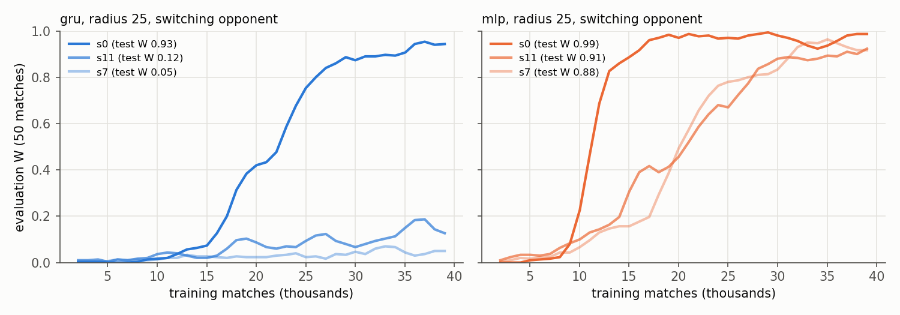

# Q2 report: How quickly can the team infer an opponent formation change?

The opponent changes formation in the middle of a match, and our team is not told. We compare a team that **identifies
the change and then acts** (a Bayesian guesser that hands the game to a specialist) with teams that were simply **trained
on switching opponents**, with memory (GRU) and without (MLP).

Blocks marked *(generated)* are filled by `football_adapt/runs/_tools/final_report.py` from the result files. Run it
again after new results arrive; it replaces only those blocks.

## 1. Answer in short

| Q2 asks | Answer |
|---|---|
| How fast is a formation change identified? | **In about 30 steps (2–3% of a match) at radius 25, 36 at radius 12**, by a Bayesian filter over the opponent positions our players see. That is about as fast as the opponent can walk to its new spots (up to 60 steps). It found every switch and gave no false alarm at radius 25. |
| How much does identifying it help? | **Almost all of what knowing it would give.** Handing over to the 1-2-2 specialist on the guess scores W 0.74 against 0.75 for an oracle that is told the switch (regret 0.01 ± 0.04); not switching at all scores 0.46. When the opponent switches on the score instead, the guess still keeps W 0.73 against 0.75. |
| How much does vision matter? | **Radius 12 costs the guess more:** regret 0.07 ± 0.06 W against 0.01 at radius 25. Without player numbers the guess must recognise the shape alone: delay 68 steps and false alarms in 23% of matches at radius 25, regret 0.14 at radius 12. |
| Does learning find inference by itself? | **It does not need to.** A team trained on switching opponents learns one way of playing that beats both formations. The memoryless MLP did at least as well as the GRU, and the GRU's own memory does not track the formation reliably (a read-out of it wrongly reports 1-2-2 in 89% of matches). Training with memory was also less reliable: only 1 of 3 GRU seeds learned to win (test W 0.93, 0.12, 0.05; §3.3), while all 3 MLP seeds did (0.99, 0.91, 0.88; §4, conclusion 3). |

## 2. What was run

### 2.1 The switch

The opponent (the scripted zonal team) starts in 2-2-1 and switches to **1-2-2** once, at a random step between 100
and 1100 of the 1,200. 1-2-2 is a formation the general team never trained against: it wins
W 0.04 against it. Radius 12 also starts from 3-1-1. A second test lets the opponent switch **on the score**: it goes to
1-2-2 when it trails and to 3-1-1 when it leads, checked every 50 steps.

### 2.2 Teams

| team | what it is |
|---|---|
| none | the general team (trained against 2-2-1, 2-1-2, 1-3-1, 3-1-1) plays the whole match |
| oracle | the general team, and at the moment of the switch the 1-2-2 specialist takes over: the upper bound for identify-then-act |
| guess | the specialist takes over while the guesser says 1-2-2 |
| guess (anonymous) | the same, but the guesser is not told which opponent is which player |
| gru | one recurrent policy (GRU) trained from scratch on exactly this switch (2-2-1 → 1-2-2 in the window) |
| mlp | the same training without memory: the fair memoryless baseline for the GRU |

**The general team and the specialist are deliberately moderate checkpoints** of equal strength (W about 0.75, goal
difference +1.9 at radius 25; `runs/q2/pairs/README.md`). A fully trained specialist wins 99% of its matches even after
a late handover, so the cost of a slow guess would not show. The GRU and MLP are their best checkpoints after full
training. **So the W of gru/mlp is not comparable with the W of the pair.** For them the meaningful numbers are how much
they lose at the switch and how they compare with each other.

### 2.3 The guesser (`agents/belief_filter.py`)

Position maps, counted on 400 practice matches, say how often each opponent player stands in each 10 m box for every
formation and ball state. Our players pool what they see. Every step the filter allows for a switch (chance h), then
weights each formation by how well its map explains the current view, raised to the power β < 1, since consecutive
steps show nearly the same picture. A formation becomes the guess after leading for m steps. Tuned on 200 practice
switch matches: β 0.1, h 0.0001, m 1. Tested on 300 new matches (seeds 60000+); every team plays the same 300 matches.

### 2.4 Changes from the plan in `questions.md`

| Plan | What was run | Why |
|---|---|---|
| held-out switch times and formation pairs | held-out switch times (seeds), **one target formation (1-2-2)** | specialists for every formation would multiply the training; 1-2-2 is the formation the general team loses to |
| specialist with no switching / oracle / guess / GRU | all four, plus an **MLP** trained the same way as the GRU | without it a GRU result cannot say whether memory is what helps |
| 2 radii | **12 and 25** | as in Q1 |

## 3. Results

### 3.1 Switch test at radius 25 (300 matches)

| team | W | goals | goal difference | after the switch | regret vs oracle (W) |
|---|---|---|---|---|---|
| none | 0.46 | 2.60 – 2.97 | −0.37 | −1.61 | +0.29 ± 0.05 |
| oracle | 0.75 | 4.06 – 2.63 | +1.42 | +0.18 | – |
| **guess** | **0.74** | 4.02 – 2.59 | +1.43 | +0.19 | **+0.01 ± 0.04** |
| gru (s0) | 0.96 | 5.77 – 3.01 | +2.76 | +1.56 | (a full-strength team) |
| mlp (s0) | 0.99 | 10.64 – 0.73 | +9.91 | +4.45 | (a full-strength team) |

- **The guess is as good as being told.** Median delay 28 steps (mean 29), every switch found, no false alarm. It
  is on the wrong team about 31 steps a match after the switch.
- **Not switching costs 0.29 W**: the general team is outscored 0.59 – 2.20 after the switch.
- **Adaptation lag** (goal-difference rate per 100 steps). The oracle and the guess score below their pre-switch rate
  for a few hundred steps after the handover, because the specialist starts mid-match and needs time to settle. The GRU
  loses nothing at the switch (+0.19 before, +0.26 after; table in §3.3). The MLP's rate drops from +0.86 to +0.70 but
  stays far above the others.

Switching on the score (300 matches): none 0.31, oracle 0.75, guess 0.73 (regret 0.01 ± 0.04), gru 0.83, mlp 0.93.
This test is new to the GRU and MLP, which never met an opponent that also goes to 3-1-1, and both drop (0.96 → 0.83,
0.99 → 0.93). The guess does not drop.

### 3.2 Both radii, all teams *(generated)*

<!-- AUTO:q2_switch -->
| radius | switch | team | matches | W | goal diff | goal diff after the switch | regret vs oracle (W) | guess delay (median steps) | matches with a false alarm |
|---|---|---|---|---|---|---|---|---|---|
| radius 25 | window | none | 300 | 0.46 | -0.37 | -1.61 | +0.29 ± 0.05 | – | – |
| radius 25 | window | oracle | 300 | 0.75 | +1.42 | +0.18 | – | – | – |
| radius 25 | window | guess | 300 | 0.74 | +1.43 | +0.19 | +0.01 ± 0.04 | 28 | 0% |
| radius 25 | window | gru | 300 | 0.96 | +2.76 | +1.56 | -0.21 ± 0.05 | – | – |
| radius 25 | window | mlp | 300 | 0.99 | +9.91 | +4.45 | -0.24 ± 0.05 | – | – |
| radius 25 | window | guess (anonymous) | 300 | 0.68 | +1.01 | -0.05 | +0.07 ± 0.05 | 68 | 23% |
| radius 25 | score | none | 300 | 0.31 | -0.79 | – | +0.44 ± 0.06 | – | – |
| radius 25 | score | oracle | 300 | 0.75 | +1.22 | – | – | – | – |
| radius 25 | score | guess | 300 | 0.73 | +0.99 | – | +0.01 ± 0.04 | 33 | 12% |
| radius 25 | score | gru | 300 | 0.83 | +2.27 | – | -0.08 ± 0.06 | – | – |
| radius 25 | score | mlp | 300 | 0.93 | +7.94 | – | -0.18 ± 0.05 | – | – |
| radius 25 | score | guess (anonymous) | 300 | 0.63 | +0.63 | – | +0.12 ± 0.05 | 61 | 43% |
| radius 12 | window | none | 300 | 0.25 | -2.07 | -2.56 | +0.28 ± 0.05 | – | – |
| radius 12 | window | oracle | 300 | 0.53 | -0.16 | -0.64 | – | – | – |
| radius 12 | window | guess | 300 | 0.46 | -0.49 | -0.97 | +0.07 ± 0.06 | 36 | 0% |
| radius 12 | window | gru | 300 | 0.24 | -1.22 | -0.23 | +0.28 ± 0.06 | – | – |
| radius 12 | window | mlp | 300 | 0.78 | +1.26 | +0.84 | -0.25 ± 0.06 | – | – |
| radius 12 | window | guess (anonymous) | 300 | 0.39 | -0.95 | -1.09 | +0.14 ± 0.07 | 66 | 59% |
| radius 12 | score | none | 300 | 0.23 | -1.20 | – | +0.22 ± 0.06 | – | – |
| radius 12 | score | oracle | 300 | 0.45 | -0.18 | – | – | – | – |
| radius 12 | score | guess | 300 | 0.39 | -0.58 | – | +0.07 ± 0.06 | 38 | 37% |
| radius 12 | score | gru | 300 | 0.23 | -1.22 | – | +0.22 ± 0.06 | – | – |
| radius 12 | score | mlp | 300 | 0.67 | +0.64 | – | -0.22 ± 0.07 | – | – |
| radius 12 | score | guess (anonymous) | 300 | 0.30 | -0.90 | – | +0.14 ± 0.06 | 82 | 79% |
<!-- /AUTO:q2_switch -->

Radius 12, from the guesser's own test (`runs/q2/guess/README.md`): none 0.25, oracle 0.53, guess 0.46 (regret
0.07 ± 0.06), median delay 36 steps, a false alarm in 1 of the 300 matches. The guess sometimes drops back to the general team
after the handover (59 wrong-team steps a match), which the tuning matches could not show.

### 3.3 Training the end-to-end teams, and every seed on the switch test *(generated)*

<!-- AUTO:q2_train -->
| run | seeds | test W (training opponent), mean ± 95% | each seed |
|---|---|---|---|
| gru_r25_z0 | 3 | 0.37 ± 1.22 | s0 0.93, s11 0.12, s7 0.05 |
| mlp_r25_z0 | 3 | 0.93 ± 0.14 | s0 0.99, s11 0.91, s7 0.88 |
| gru_r12_z1 | 1 | 0.21 | s0 0.21 |
| mlp_r12_z1 | 1 | 0.77 | s0 0.77 |
| f122_r25_z0 | 1 | 0.99 | s0 0.99 |
| f122_r12_z1 | 1 | 0.97 | s0 0.97 |

- gru_r25_z0: 1 of 3 seeds reach test W ≥ 0.5 (each: s0 0.93, s11 0.12, s7 0.05)
- mlp_r25_z0: 3 of 3 seeds reach test W ≥ 0.5 (each: s0 0.99, s11 0.91, s7 0.88)


<!-- /AUTO:q2_train -->

<!-- AUTO:q2_seeds -->
| switch | team | W | goal diff | goal-diff rate per 100 steps before → after the switch |
|---|---|---|---|---|
| window | oracle | 0.75 | +1.42 | +0.18 → -0.01 |
| window | gru_s0 | 0.96 | +2.76 | +0.19 → +0.26 |
| window | gru_s11 | 0.14 | -2.20 | -0.14 → -0.22 |
| window | gru_s7 | 0.04 | -3.26 | -0.30 → -0.24 |
| window | mlp_s0 | 0.99 | +9.91 | +0.86 → +0.70 |
| window | mlp_s11 | 0.92 | +1.81 | +0.10 → +0.24 |
| window | mlp_s7 | 0.88 | +2.48 | +0.37 → +0.05 |
| score | oracle | 0.75 | +1.22 | – |
| score | gru_s0 | 0.83 | +2.27 | – |
| score | gru_s11 | 0.08 | -2.22 | – |
| score | gru_s7 | 0.04 | -3.41 | – |
| score | mlp_s0 | 0.93 | +7.94 | – |
| score | mlp_s11 | 0.66 | +0.90 | – |
| score | mlp_s7 | 0.69 | +0.23 | – |
<!-- /AUTO:q2_seeds -->

### 3.4 Does the GRU's memory know the formation?

A linear read-out (logistic regression) of the GRU's hidden state was fitted on 200 practice matches to say "the
opponent is in 1-2-2 now" (`runs/q2/probe_r25.npz`). On the 300 test matches it does react fast: it first says 1-2-2
a median of 9 steps after the switch. But it also says 1-2-2 **before** the switch in 89% of matches (20 steps a match),
and on the score test in 70% of matches (114 steps a match). The memory carries something about the opponent's shape,
but nothing that would let a team decide "switch now". Together with the GRU losing nothing at the switch, this
suggests the GRU plays in a way that works against both formations rather than identifying the formation.

## 4. Conclusions for Q2

1. **Identification is fast and almost free.** From what the players see, a simple Bayesian filter finds a formation
   change in about 30 steps and keeps 97% of the oracle's gain at radius 25 (75% at radius 12).
2. **Vision and player identity matter for identification.** Radius 12 doubles what the guess loses. Without player
   numbers the delay more than doubles and false alarms appear, so the shape alone is harder to read than who stands
   where.
3. **End-to-end training does not learn inference; it learns robustness.** Trained on the switch, both the GRU and the
   memoryless MLP play one policy that beats 2-2-1 and 1-2-2 alike. Memory brings no advantage here. 2 of 3 GRU seeds did
   not learn to win at all (test W 0.12 and 0.05 against 0.93 for seed 0, §3.3); their entropy and KL stayed normal, so
   the runs did not crash, they never found a way to beat the full-strength opponent. Radius 12 shows the same: the
   MLP scores 0.78 on the switch test (above the oracle pair's 0.53), while the GRU (one seed, test W 0.21) did not
   learn and scores 0.24, the same as keeping the wrong team.
   <!-- AUTO:q2_concl -->
**Seeds.** 1 of 3 GRU seeds reached test W ≥ 0.5 (0.93, 0.12, 0.05), and 3 of 3 MLP seeds (0.99, 0.91, 0.88). Without memory more seeds learned, so in these runs **training with memory was less reliable**.
<!-- /AUTO:q2_concl -->
4. **Robustness is narrower than identification.** On a switch pattern they were not trained on (score-reactive, with
   3-1-1 as well), both end-to-end teams lose 0.06–0.13 W, while identify-then-act loses nothing.

## 5. Limitations

- **One target formation.** Every switch goes to 1-2-2, so the guesser chooses between two formations. With more
  targets the guess would need more specialists and could confuse similar shapes.
- **Moderate pair.** The general team and specialist were picked at W ≈ 0.75 so that a slow guess shows in the score.
  Their W is not comparable with the fully trained GRU/MLP.
- **Seeds.** The pair and the guesser are single runs. The end-to-end teams have three seeds each at radius 25 (§3.3)
  and one at radius 12. Two of the three GRU seeds failed to learn, so the GRU result of §3.1 rests on its one good seed.
- **Mid-match handover.** A specialist that comes on mid-match plays below its kick-off level for a few hundred steps
  (adaptation lag), and this counts against both the oracle and the guess.
- **The memory read-out is linear.** A non-linear probe might find more in the GRU's state. The point stands that the
  team does not act on a formation belief.

## 6. Files and how to reproduce

| What | Where (under `football_adapt/`) |
|---|---|
| Pairs (general team and specialist) | `runs/q2/pairs/README.md` (`runs/_tools/ckpt_vs_form.py`) |
| Guesser maps, tuning, offline test | `runs/q2/guess/r{25,12}/`, `runs/q2/guess_anon/r{25,12}/` (`run_all.sh`) |
| End-to-end teams | `runs/q2/gru_r25_z0/s{0,7,11}`, `mlp_r25_z0/s{0,7,11}`, `gru_r12_z1/s0`, `mlp_r12_z1/s0` |
| Switch tests | `runs/q2/test/r{25,12}_{window,score}_{guess,guess_anon}.{jsonl,txt}`, seeds: `r25_{window,score}_seeds.*` |
| Memory read-out | `runs/q2/probe_r{25,12}.npz` (`python -m scripts.q2 probe`) |
| Tables and figures in this report | `runs/_tools/final_report.py` → `docs/results_final.md`, `docs/img/final/` |

The test at radius 25 (on a server, from `football_adapt/`):

```bash
python -m scripts.q2 test --general runs/q1/z0_r25/s0/ckpts/m030000.pt \
       --specialist runs/q2/f122_r25_z0/s0/ckpts/m005040.pt --starts 2-2-1 \
       --maps runs/q2/guess/r25/maps.npz --filter runs/q2/guess/r25/filter.json \
       --team gru=runs/q2/gru_r25_z0/s0/ckpts/m040032.pt --team mlp=runs/q2/mlp_r25_z0/s0/ckpts/m039024.pt \
       --probe runs/q2/probe_r25.npz --mode window --out runs/q2/test/r25_window_guess.jsonl
```
