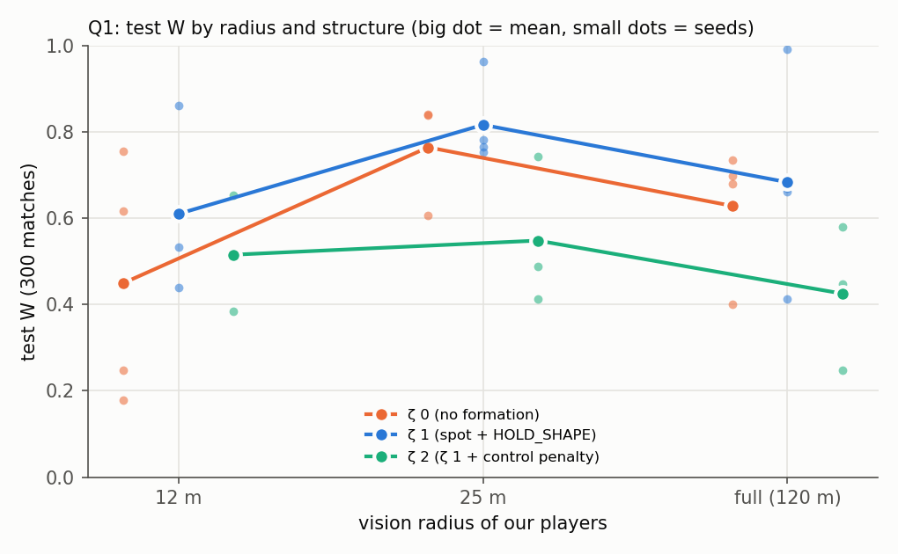
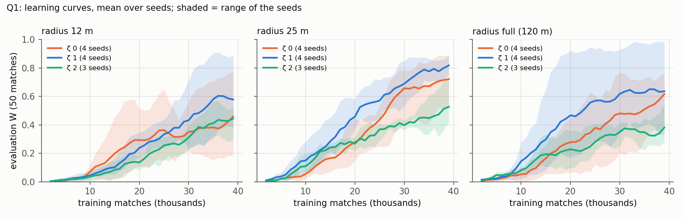
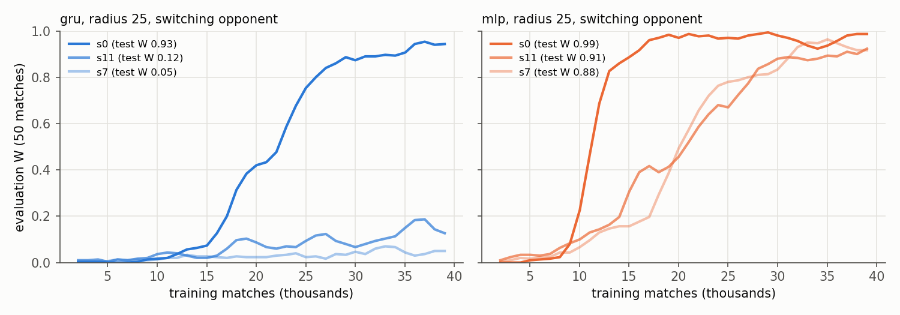

# Final results (generated)

Generated by `football_adapt/runs/_tools/final_report.py` on 2026-11-20 06:52 UTC from the result files. Do not edit by hand: run the script again.

Test W = wins + draws/2 over 300 new matches per run. Intervals are 95% over training seeds (Welch for differences). A result from one seed has no interval and is not a finding on its own.

## Automatic verdicts

- B₁(r) = W(ζ 1) − W(ζ 0) at 12 m: +0.16 [-0.27, +0.59]: **not distinguishable from 0** with these seeds.
- B₁(r) = W(ζ 1) − W(ζ 0) at 25 m: +0.05 [-0.13, +0.23]: **not distinguishable from 0** with these seeds.
- B₁(r) = W(ζ 1) − W(ζ 0) at full (120 m): +0.05 [-0.31, +0.42]: **not distinguishable from 0** with these seeds.
- B₂(r) = W(ζ 2) − W(ζ 0) at 12 m: +0.07 [-0.36, +0.49]: **not distinguishable from 0** with these seeds.
- B₂(r) = W(ζ 2) − W(ζ 0) at 25 m: -0.22 [-0.57, +0.14]: **not distinguishable from 0** with these seeds.
- B₂(r) = W(ζ 2) − W(ζ 0) at full (120 m): -0.20 [-0.54, +0.13]: **not distinguishable from 0** with these seeds.
- W(ζ 2) − W(ζ 1): the control penalty at 12 m: -0.09 [-0.40, +0.21]: **not distinguishable from 0** with these seeds.
- W(ζ 2) − W(ζ 1): the control penalty at 25 m: -0.27 [-0.62, +0.09]: **not distinguishable from 0** with these seeds.
- W(ζ 2) − W(ζ 1): the control penalty at full (120 m): -0.26 [-0.65, +0.13]: **not distinguishable from 0** with these seeds.
- B for ζ 1: B(12 m) − B(25 m) (does the benefit grow as r shrinks?): +0.11 [-0.40, +0.61]: **not distinguishable from 0** with these seeds.
- B for ζ 1: B(12 m) − B(full (120 m)) (does the benefit grow as r shrinks?): +0.10 [-0.50, +0.71]: **not distinguishable from 0** with these seeds.
- B for ζ 2: B(12 m) − B(25 m) (does the benefit grow as r shrinks?): +0.28 [-0.26, +0.83]: **not distinguishable from 0** with these seeds.
- B for ζ 2: B(12 m) − B(full (120 m)) (does the benefit grow as r shrinks?): +0.27 [-0.29, +0.83]: **not distinguishable from 0** with these seeds.
- Q1 formation at 12 m: W(2-2-1) − W(1-2-2): +0.07 [-0.33, +0.47]: **not distinguishable from 0** with these seeds.
- Q1 formation at 12 m: W(2-2-1) − W(1-3-1): +0.28 [-0.11, +0.68]: **not distinguishable from 0** with these seeds.
- Q1 formation at 25 m: W(2-2-1) − W(1-3-1): +0.14 [-3.17, +3.45]: **not distinguishable from 0** with these seeds.
- Q1 formation at 25 m: W(2-2-1) − W(1-2-2): +0.18, from single seeds, so no interval: **not a result on its own**.
- Q1 formation at full (120 m): W(1-3-1) − W(2-2-1): +0.17, from single seeds, so no interval: **not a result on its own**.
- Q1 formation at full (120 m): W(1-3-1) − W(1-2-2): +0.38, from single seeds, so no interval: **not a result on its own**.
- Q2 (r 25, single switch): the Bayesian guess detects the switch after a median 28 steps and loses +0.01 ± 0.04 W against the oracle; keeping the wrong team loses +0.29.
- Q2 switch test, W(GRU seeds) − W(MLP seeds): does memory help?: -0.55 [-1.80, +0.70]: **not distinguishable from 0** with these seeds.
- Q3, W(mix) − W(mix_ns) over the played cases (paired by match): **-0.15** [-0.17, -0.14]: **negative, the interval excludes 0**.
- Q3, W(mix_told) − W(mix) over the played cases (paired by match): **+0.02** [+0.01, +0.03]: **positive, the interval excludes 0**.
- Q3, W(mix) − W(adaptive) over the played cases (paired by match): **+0.19** [+0.17, +0.21]: **positive, the interval excludes 0**.
- Q3, W(mix) − W(oracle) over the played cases (paired by match): **+0.13** [+0.11, +0.15]: **positive, the interval excludes 0**.

## Q1. Can formation structure compensate for limited vision?

### Test W of every setting

| setting | radius | seeds | test W, mean ± 95% interval over seeds | seed sd | each seed |
|---|---|---|---|---|---|
| ζ 0 (no formation) | 12 m | 4 | 0.45 ± 0.45 | 0.28 | s0 0.18, s11 0.62, s42 0.76, s7 0.25 |
| ζ 0 (no formation) | 25 m | 4 | 0.76 ± 0.18 | 0.11 | s0 0.84, s11 0.60, s42 0.84, s7 0.77 |
| ζ 0 (no formation) | full (120 m) | 4 | 0.63 ± 0.24 | 0.15 | s0 0.40, s11 0.68, s42 0.70, s7 0.73 |
| ζ 1 (spot + HOLD_SHAPE) | 12 m | 4 | 0.61 ± 0.29 | 0.18 | s0 0.60, s11 0.44, s42 0.53, s7 0.86 |
| ζ 1 (spot + HOLD_SHAPE) | 25 m | 4 | 0.82 ± 0.16 | 0.10 | s0 0.75, s11 0.78, s42 0.77, s7 0.96 |
| ζ 1 (spot + HOLD_SHAPE) | full (120 m) | 4 | 0.68 ± 0.38 | 0.24 | s0 0.67, s11 0.41, s42 0.66, s7 0.99 |
| ζ 2 (ζ 1 + control penalty) | 12 m | 3 | 0.52 ± 0.33 | 0.13 | s0 0.65, s11 0.39, s7 0.51 |
| ζ 2 (ζ 1 + control penalty) | 25 m | 3 | 0.55 ± 0.43 | 0.17 | s0 0.74, s11 0.41, s7 0.49 |
| ζ 2 (ζ 1 + control penalty) | full (120 m) | 3 | 0.42 ± 0.41 | 0.17 | s0 0.58, s11 0.45, s7 0.25 |
| ζ 1, our formation 1-3-1 | 12 m | 4 | 0.33 ± 0.41 | 0.26 | s0 0.27, s11 0.29, s42 0.07, s7 0.68 |
| ζ 1, our formation 1-3-1 | 25 m | 2 | 0.68 ± 3.41 | 0.38 | s0 0.95, s7 0.41 |
| ζ 1, our formation 1-3-1 | full (120 m) | 1 | 0.85 | – | s0 0.85 |
| ζ 1, our formation 1-2-2 | 12 m | 4 | 0.54 ± 0.42 | 0.26 | s0 0.80, s11 0.71, s42 0.38, s7 0.26 |
| ζ 1, our formation 1-2-2 | 25 m | 1 | 0.64 | – | s0 0.64 |
| ζ 1, our formation 1-2-2 | full (120 m) | 1 | 0.46 | – | s0 0.46 |

### Benefit of structure (Welch 95% intervals over seeds)

| difference | 12 m | 25 m | full (120 m) |
|---|---|---|---|
| B₁(r) = W(ζ 1) − W(ζ 0) | +0.16 ± 0.43 | +0.05 ± 0.18 | +0.05 ± 0.36 |
| B₂(r) = W(ζ 2) − W(ζ 0) | +0.07 ± 0.43 | -0.22 ± 0.35 | -0.20 ± 0.34 |
| W(ζ 2) − W(ζ 1): the control penalty | -0.09 ± 0.31 | -0.27 ± 0.35 | -0.26 ± 0.39 |

- B₁(r) = W(ζ 1) − W(ζ 0) at 12 m: +0.16 [-0.27, +0.59]: **not distinguishable from 0** with these seeds.
- B₁(r) = W(ζ 1) − W(ζ 0) at 25 m: +0.05 [-0.13, +0.23]: **not distinguishable from 0** with these seeds.
- B₁(r) = W(ζ 1) − W(ζ 0) at full (120 m): +0.05 [-0.31, +0.42]: **not distinguishable from 0** with these seeds.
- B₂(r) = W(ζ 2) − W(ζ 0) at 12 m: +0.07 [-0.36, +0.49]: **not distinguishable from 0** with these seeds.
- B₂(r) = W(ζ 2) − W(ζ 0) at 25 m: -0.22 [-0.57, +0.14]: **not distinguishable from 0** with these seeds.
- B₂(r) = W(ζ 2) − W(ζ 0) at full (120 m): -0.20 [-0.54, +0.13]: **not distinguishable from 0** with these seeds.
- W(ζ 2) − W(ζ 1): the control penalty at 12 m: -0.09 [-0.40, +0.21]: **not distinguishable from 0** with these seeds.
- W(ζ 2) − W(ζ 1): the control penalty at 25 m: -0.27 [-0.62, +0.09]: **not distinguishable from 0** with these seeds.
- W(ζ 2) − W(ζ 1): the control penalty at full (120 m): -0.26 [-0.65, +0.13]: **not distinguishable from 0** with these seeds.

### Does the benefit grow as the radius shrinks?

- B for ζ 1: B(12 m) − B(25 m) (does the benefit grow as r shrinks?): +0.11 [-0.40, +0.61]: **not distinguishable from 0** with these seeds.
- B for ζ 1: B(12 m) − B(full (120 m)) (does the benefit grow as r shrinks?): +0.10 [-0.50, +0.71]: **not distinguishable from 0** with these seeds.
- B for ζ 2: B(12 m) − B(25 m) (does the benefit grow as r shrinks?): +0.28 [-0.26, +0.83]: **not distinguishable from 0** with these seeds.
- B for ζ 2: B(12 m) − B(full (120 m)) (does the benefit grow as r shrinks?): +0.27 [-0.29, +0.83]: **not distinguishable from 0** with these seeds.

### Our formation, by radius (ζ 1)

| radius | 2-2-1 | 1-3-1 | 1-2-2 | best |
|---|---|---|---|---|
| 12 m | 0.61 (n=4) | 0.33 (n=4) | 0.54 (n=4) | 2-2-1 |
| 25 m | 0.82 (n=4) | 0.68 (n=2) | 0.64 (n=1) | 2-2-1 |
| full (120 m) | 0.68 (n=4) | 0.85 (n=1) | 0.46 (n=1) | 1-3-1 |

The 1-3-1 and 1-2-2 teams have one seed each, so these are single runs, not settled differences.

### Against each opponent formation (W over 50 matches each, mean over seeds)

| setting | radius | seeds | 2-2-1 | 2-1-2 | 1-3-1 | 3-1-1 | 1-2-2 (never trained) |
|---|---|---|---|---|---|---|---|
| ζ 0 (no formation) | 12 m | 4 | 0.43 | 0.38 | 0.32 | 0.64 | 0.01 |
| ζ 0 (no formation) | 25 m | 4 | 0.80 | 0.76 | 0.45 | 0.89 | 0.07 |
| ζ 0 (no formation) | full (120 m) | 4 | 0.67 | 0.52 | 0.44 | 0.75 | 0.02 |
| ζ 1 (spot + HOLD_SHAPE) | 12 m | 4 | 0.64 | 0.57 | 0.44 | 0.79 | 0.05 |
| ζ 1 (spot + HOLD_SHAPE) | 25 m | 4 | 0.88 | 0.85 | 0.71 | 0.93 | 0.04 |
| ζ 1 (spot + HOLD_SHAPE) | full (120 m) | 4 | 0.76 | 0.77 | 0.38 | 0.83 | 0.24 |
| ζ 2 (ζ 1 + control penalty) | 12 m | 3 | 0.66 | 0.48 | 0.25 | 0.57 | 0.01 |
| ζ 2 (ζ 1 + control penalty) | 25 m | 3 | 0.64 | 0.54 | 0.22 | 0.62 | 0.01 |
| ζ 2 (ζ 1 + control penalty) | full (120 m) | 3 | 0.56 | 0.38 | 0.21 | 0.53 | 0.06 |
| ζ 1, our formation 1-3-1 | 12 m | 4 | 0.30 | 0.32 | 0.18 | 0.46 | 0.06 |
| ζ 1, our formation 1-3-1 | 25 m | 2 | 0.71 | 0.58 | 0.58 | 0.76 | 0.22 |
| ζ 1, our formation 1-3-1 | full (120 m) | 1 | 0.72 | 0.96 | 0.72 | 0.94 | 0.41 |
| ζ 1, our formation 1-2-2 | 12 m | 4 | 0.66 | 0.45 | 0.34 | 0.70 | 0.08 |
| ζ 1, our formation 1-2-2 | 25 m | 1 | 0.58 | 0.74 | 0.24 | 0.80 | 0.02 |
| ζ 1, our formation 1-2-2 | full (120 m) | 1 | 0.46 | 0.73 | 0.01 | 0.47 | 0.00 |

## Q2. How quickly can the team infer an opponent formation change?

### Training results (W against the training opponent)

| run | seeds | test W (training opponent), mean ± 95% | each seed |
|---|---|---|---|
| gru_r25_z0 | 3 | 0.37 ± 1.22 | s0 0.93, s11 0.12, s7 0.05 |
| mlp_r25_z0 | 3 | 0.93 ± 0.14 | s0 0.99, s11 0.91, s7 0.88 |
| gru_r12_z1 | 1 | 0.21 | s0 0.21 |
| mlp_r12_z1 | 1 | 0.77 | s0 0.77 |
| f122_r25_z0 | 1 | 0.99 | s0 0.99 |
| f122_r12_z1 | 1 | 0.97 | s0 0.97 |

- gru_r25_z0: 1 of 3 seeds reach test W ≥ 0.5 (each: s0 0.93, s11 0.12, s7 0.05)
- mlp_r25_z0: 3 of 3 seeds reach test W ≥ 0.5 (each: s0 0.99, s11 0.91, s7 0.88)

### Switch test (300 matches, seeds 60000+; the specialist pair is deliberately moderate, see runs/q2/pairs)

| radius | switch | team | matches | W | goal diff | goal diff after the switch | regret vs oracle (W) | guess delay (median steps) | matches with a false alarm |
|---|---|---|---|---|---|---|---|---|---|
| radius 25 | window | none | 300 | 0.46 | -0.37 | -1.61 | +0.29 ± 0.05 | – | – |
| radius 25 | window | oracle | 300 | 0.75 | +1.42 | +0.18 | – | – | – |
| radius 25 | window | guess | 300 | 0.74 | +1.43 | +0.19 | +0.01 ± 0.04 | 28 | 0% |
| radius 25 | window | gru | 300 | 0.96 | +2.76 | +1.56 | -0.21 ± 0.05 | – | – |
| radius 25 | window | mlp | 300 | 0.99 | +9.91 | +4.45 | -0.24 ± 0.05 | – | – |
| radius 25 | window | guess (anonymous) | 300 | 0.68 | +1.01 | -0.05 | +0.07 ± 0.05 | 68 | 23% |
| radius 25 | score | none | 300 | 0.31 | -0.79 | – | +0.44 ± 0.06 | – | – |
| radius 25 | score | oracle | 300 | 0.75 | +1.22 | – | – | – | – |
| radius 25 | score | guess | 300 | 0.73 | +0.99 | – | +0.01 ± 0.04 | 33 | 12% |
| radius 25 | score | gru | 300 | 0.83 | +2.27 | – | -0.08 ± 0.06 | – | – |
| radius 25 | score | mlp | 300 | 0.93 | +7.94 | – | -0.18 ± 0.05 | – | – |
| radius 25 | score | guess (anonymous) | 300 | 0.63 | +0.63 | – | +0.12 ± 0.05 | 61 | 43% |
| radius 12 | window | none | 300 | 0.25 | -2.07 | -2.56 | +0.28 ± 0.05 | – | – |
| radius 12 | window | oracle | 300 | 0.53 | -0.16 | -0.64 | – | – | – |
| radius 12 | window | guess | 300 | 0.46 | -0.49 | -0.97 | +0.07 ± 0.06 | 36 | 0% |
| radius 12 | window | gru | 300 | 0.24 | -1.22 | -0.23 | +0.28 ± 0.06 | – | – |
| radius 12 | window | mlp | 300 | 0.78 | +1.26 | +0.84 | -0.25 ± 0.06 | – | – |
| radius 12 | window | guess (anonymous) | 300 | 0.39 | -0.95 | -1.09 | +0.14 ± 0.07 | 66 | 59% |
| radius 12 | score | none | 300 | 0.23 | -1.20 | – | +0.22 ± 0.06 | – | – |
| radius 12 | score | oracle | 300 | 0.45 | -0.18 | – | – | – | – |
| radius 12 | score | guess | 300 | 0.39 | -0.58 | – | +0.07 ± 0.06 | 38 | 37% |
| radius 12 | score | gru | 300 | 0.23 | -1.22 | – | +0.22 ± 0.06 | – | – |
| radius 12 | score | mlp | 300 | 0.67 | +0.64 | – | -0.22 ± 0.07 | – | – |
| radius 12 | score | guess (anonymous) | 300 | 0.30 | -0.90 | – | +0.14 ± 0.06 | 82 | 79% |

### Every seed of the end-to-end teams on the radius-25 switch test

| switch | team | W | goal diff | goal-diff rate per 100 steps before → after the switch |
|---|---|---|---|---|
| window | oracle | 0.75 | +1.42 | +0.18 → -0.01 |
| window | gru_s0 | 0.96 | +2.76 | +0.19 → +0.26 |
| window | gru_s11 | 0.14 | -2.20 | -0.14 → -0.22 |
| window | gru_s7 | 0.04 | -3.26 | -0.30 → -0.24 |
| window | mlp_s0 | 0.99 | +9.91 | +0.86 → +0.70 |
| window | mlp_s11 | 0.92 | +1.81 | +0.10 → +0.24 |
| window | mlp_s7 | 0.88 | +2.48 | +0.37 → +0.05 |
| score | oracle | 0.75 | +1.22 | – |
| score | gru_s0 | 0.83 | +2.27 | – |
| score | gru_s11 | 0.08 | -2.22 | – |
| score | gru_s7 | 0.04 | -3.41 | – |
| score | mlp_s0 | 0.93 | +7.94 | – |
| score | mlp_s11 | 0.66 | +0.90 | – |
| score | mlp_s7 | 0.69 | +0.23 | – |

## Q3. Can the team identify and neutralize an opponent playmaker?

### Training

| run | test W on its training cases (each seed) | still training |
|---|---|---|
| mixw_r25_z0 | s0 0.71 | – |
| mixw_told_r25_z0 | s0 0.72 | – |
| mixw_ns_r25_z0 | s0 0.85 | – |
| mix_r25_z0 | s0 0.01 | – |
| oracle_r25_z0 | s0 0.02 | – |
| mix_ns_r25_z0 | s0 0.01 | – |
| pm2_r25_z0 | s0 0.69 | – |
| pm4_r25_z0 | s0 0.43 | – |
| pm3_r25_z0 | s0 0.25 | – |

### All teams on the same matches (W per case; regret paired by seed)

| case (formation:playmaker) | unaware | oracle | adaptive | mix | mix_ns | mix_told |
|---|---|---|---|---|---|---|
| 1-3-1:2 | 0.22 | 0.71 | 0.50 | 0.68 | 0.85 | 0.76 |
| 1-3-1:3 | 0.22 | 0.22 | 0.23 | 0.69 | 0.86 | 0.65 |
| 1-3-1:4 | 0.02 | 0.12 | 0.04 | 0.54 | 0.81 | 0.69 |
| 2-1-2:3 | 0.37 | 0.37 | 0.37 | 0.80 | 0.91 | 0.84 |
| 2-2-1:3 | 0.41 | 0.41 | 0.41 | 0.81 | 0.87 | 0.85 |
| 2-2-1:4 | 0.21 | 0.46 | 0.32 | 0.74 | 0.90 | 0.84 |
| 3-1-1:4 | 0.36 | 0.65 | 0.56 | 0.65 | 0.82 | 0.65 |
| 1-3-1:0 | 0.82 | 0.82 | 0.80 | 0.65 | 0.85 | 0.66 |
| 2-1-2:0 | 0.83 | 0.83 | 0.82 | 0.81 | 0.92 | 0.76 |
| 2-2-1:0 | 0.87 | 0.87 | 0.78 | 0.75 | 0.88 | 0.81 |
| 3-1-1:0 | 0.90 | 0.90 | 0.84 | 0.66 | 0.77 | 0.49 |
| **mean regret vs the specialist oracle** | +0.10 | – | +0.06 | -0.13 | -0.28 | -0.15 |

